# biz 层交接文档（Handover）

> 适用范围：`go_agent/internal/biz` 全部模块
> 代码基线：2026-11-01（含会话辩论暂停/恢复、统一操作历史 `conv_id` 继承、评测 harness 骨架、
> AgentFactory 优雅停机 draining、平台只读 MCP 端点 `platformmcp`）
> 读者：接手本仓库的后端同学、需要改 biz 行为的平台开发、排查线上问题的值班同学
> 配套文档：`biz/rag/DESIGN.md`（RAG 详解）、`biz/rag/graphrag/DESIGN.md`（GraphRAG 详解）、`biz/harness/设计方案.md`（评测体系设计）、`biz/agentfactory/DESIGN.md`（Agent 低代码工厂讨论稿）

---

## 0. 怎么用这份文档

| 你的目的 | 直接看 |
| --- | --- |
| 第一次接手，先建立全局认识 | 第 1 章「总览」+ 1.4 三条纵贯链路时序图 |
| 要改某个业务（会话/任务/检索/记忆…） | 第 2 章对应模块的「改动指南」 |
| 排查「为什么没有记录 / 为什么状态不对」 | 第 3 章「跨模块协作」+ 第 5 章「已知问题」 |
| 加一个新模块 | 第 4 章「新增模块 checklist」 |
| 想知道停机时任务会怎样 / 为什么排空要等 20s | 2.2「优雅停机（draining）」 |
| 线上启动失败 / 卡住 / 队列不动 | 第 6 章「运维与排障速查」 |

**一条铁律**：`biz` 层只依赖接口（每个包里的 `ports.go` 或主文件顶部的 `Repo interface`），
**不允许 import `internal/data`**。所有具体实现在 `internal/data` 与 `biz` 其他子包，由 `biz.go`（biz 侧）
与 `data.go`（data 侧）的 wire ProviderSet 拼装。看到 biz 里出现 `gorm`、`milvusclient`、`redis` 字样，
基本可以判定是分层被破坏了。

---

## 1. 总览

### 1.1 分层与依赖方向

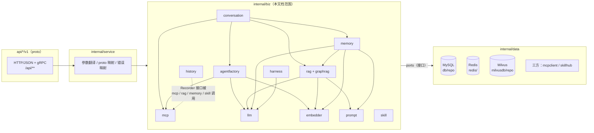

依赖是**单向**的：`service → biz → data`。biz 内部允许「编排型模块」调「能力型模块」：

| 编排方 | 被调用方 | 调用内容 |
| --- | --- | --- |
| `conversation` | `agentfactory` / `mcp` / `memory` / `rag` / `llm` | 会话链路：召回复用 + 工具委派 + 对话模型 |
| `agentfactory` | `mcp`（ToolPort）/ `llm`（Chatter）/ `embedder`（Embedder） | 工具能力、模型调用、Agent 定义向量化 |
| `rag` | `prompt` / `llm` / `embedder` / `graphrag` | 提示词、生成、向量化、图谱线路 |
| `memory` | `prompt` / `llm` / `embedder` / `rag` / `graphrag` | 同上 + 复用图谱集合 |
| `harness` | 通过 `Runner` 端口间接调 `agentfactory` / `llm` | 黑盒执行被测对象 |

### 1.2 模块地图

| 模块 | 一句话职责 | 对外入口（HTTP） | 主要存储 | 测试 |
| --- | --- | --- | --- | --- |
| `conversation` | 会话目录 + 消息 + LLM 编排对话 + 多角色辩论 | `/api/conversations/**` | MySQL `conversations` `conversation_messages` `debates` | `conversation_test.go` `chat_test.go` |
| `agentfactory` | Agent 低代码工厂：定义/任务/事件/12 种执行图/worker 池/定时调度 | `/api/agentfactory/**` | MySQL `agent_definitions` `agent_tasks` `agent_task_history` `agent_task_events`；Milvus `{base}_agents`；Redis `af:*` | `agentfactory_test.go` `graph*_test.go` `workflow_test.go` `cron_test.go` |
| `harness` | 评测用例集：黑盒执行 + 规则断言 + LLM Judge + 报告 | `/api/harness/**` | MySQL `harness_sets` `harness_cases` `harness_runs` `harness_run_items` | `harness_test.go` |
| `memory` | 短期（Redis）+ 长期（MySQL+Milvus）+ 记忆图谱 | `/api/memory/**` | MySQL `memories`；Redis `mem:short:*`；Milvus `{base}_memories` | `memory_test.go` |
| `rag` | 文档入库 + 混合检索问答 + GraphRAG 图谱 | `/api/ingest` `/api/query` `/api/graph/**` | MySQL `rag_documents`；Milvus `{base}`；Redis `rag:ans:*` `rag:lock:ingest:*` | `rag_test.go` `chunker_test.go` |
| `prompt` | 提示词模板版本化 + 在线生效 + 渲染 | `/api/prompts/**` | MySQL `prompt_templates` `prompt_versions`；Redis `prompt:ver:*` | `prompt_test.go` `template_test.go` |
| `mcp` | MCP 服务/工具生命周期、语义召回、调用 | `/api/mcp/**` | MySQL `mcp_servers` `tools`；Milvus `{base}_tools`；Redis `mcp:tool:*` `mcp:status:*` `ns:tools:*` | 无单测（靠 contract 手测） |
| `platformmcp` | 平台只读 MCP 工具：任务中心 / 会话 / 链路 / 操作历史（7 个工具） | `/mcp/platform`（server 层挂载） | 只读复用 agentfactory / conversation / history 用例 | `platformmcp_test.go` |
| `llm` | 多数据源管理 + 场景路由 + 故障切换 + 调用历史 | `/api/llm/**` `/api/llm/calls` | MySQL `llm_providers` `llm_calls` | `manager_test.go` `llm_test.go` |
| `skill` | 技能安装/启停/卸载 + 技能市场 + 落盘 + URL 安装 | `/api/skills/**` `/api/skillhub/**` | MySQL `skills` `skill_files` `skill_hubs`；磁盘 `sync_dir` | `skill_test.go` |
| `aiplatform` | 外部 AI 平台（千问 / 百炼）：平台登记 + 目录搜索 + MCP 一键接入 + 技能市场联动 | `/api/aiplatform/**` | MySQL `ai_platforms` | `aiplatform_test.go` |
| `history` | 统一操作历史（5 类「用到了什么」） | `/api/histories` | MySQL `op_histories` | `history_test.go`（ctx 身份叠加） |
| `embedder` | OpenAI 兼容 Embedding 客户端 | 无（内部能力） | 无 | 无单测 |
| `agent` | **空目录**（历史残留，无 Go 文件） | — | — | — |

> `{base}` = `data.milvus.collection`，默认 `rag_docs`。派生集合：`_graph_entities`、`_graph_relations`、`_memories`、`_tools`、`_agents`。

### 1.3 装配关系（wire）

biz 侧 `biz.go` 只做「不需要三方连接件」的构造与接口绑定：

```text
prompt.New                         → 绑定 rag.Prompter
rag.NewRag                         → 构造 Rag（graphrag.Service 在内部 New）
memory.New                         → 构造记忆用例（启动即 EnsureCollection）
history.New                        → 绑定 history.Recorder
conversation.NewUseCase            → 会话用例（启动即收尾孤儿辩论）
wire.Struct(conversation.ChatDeps) → 注入 LLM / Rag / Memory / MCP / Agents
embedder.NewEmbedding              → 绑定 rag.Embedder / agentfactory.Embedder
```

data 侧 `data.go` 负责「需要连接件」的构造：`db.NewData`（GORM）、`redis.NewRDBData`、`milvusdb.New`、
`mcp.New`（依赖 dialer / client provider）、`skill.New`、`agentfactory.New`、`llm.NewManager`，
以及所有 `wire.Bind(接口 ← 实现)`。

注意几个容易踩的点：

- `mcp.New` 在 **data 侧**，`biz.go` 只补 `mcp.Embedder` 绑定。
- `rag.Chatter` 与 `agentfactory.Chatter` 都绑定到 `*llm.Manager`，不是 `llm.Client`。
- `agentfactory.ToolPort` 绑定到 **`*mcp.UseCase` 本身**（同一个实例，不是副本），所以 MCP 工具的向量/缓存
  与 Agent 看到的能力目录是同一份。
- `agentfactory.SkillPort` 绑定到 `*skill.UseCase`（同上，跨层绑定写在 `wire.go`）：能力目录会列启用技能
  （`skill:<name>`），调用技能 = 把 SKILL.md 说明文本喂回 LLM（技能是指令包，不是可执行程序）。
- `harness.Runner ← *harnessrunner.Runner`、`harness.Chatter ← *llm.Manager` 在 `data.ProviderSet` 内
  （适配器与被绑定的具体类型同层构造，不涉及跨层问题）。
- `harness` 已接线（2026-11-02）：`dbrepo.NewHarnessRepo` + `harnessrunner.New`（agent: → `agentfactory.RunOnce`，
  model: → `llm.Manager`）+ `harness.Chatter ← *llm.Manager`，全在 `data.ProviderSet`；`harness.New` 也在 data 侧。
  注意 `agentfactory.RunOnce` 是 harness 专用的同步执行入口（建独立任务记录并内联执行）。
- **跨层绑定写在 `cmd/go_agent/wire.go`**：实现由 data 侧构造、接口声明在 biz 的绑定
  （`aiplatform.MCPRegistry ← *mcp.UseCase`、`aiplatform.SkillMarkets ← *skill.UseCase`、
  `platformmcp.TaskSource/ConvSource/HistorySource`）必须放进合并后的 `wire.Build`。
  放进 `biz.ProviderSet` 会报 `wire.Bind of concrete type ... but ProviderSet does not include a provider`，
  因为 biz 图里根本没有那个具体类型的构造者。

### 1.4 三条纵贯链路（先看这三张图）

平台所有请求，本质上是三条链路的组合。先建立这三条链路的心智模型，后面每个模块的细节都能挂上去。

**（A）会话链路：用户发一句话，系统召回上下文 + 自主调工具 + 落消息**

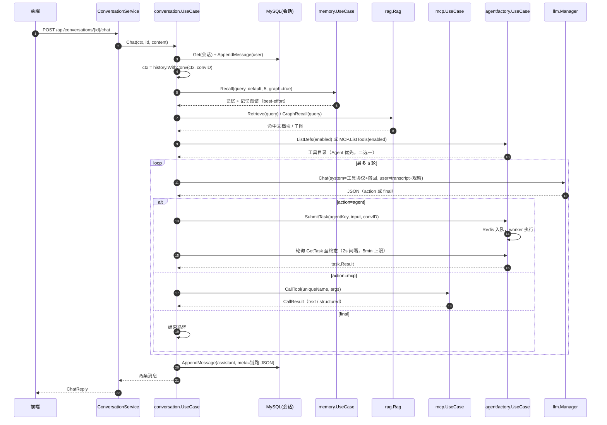

**（B）任务链路：Agent 定义 → 异步任务 → 执行图 → 事件流**

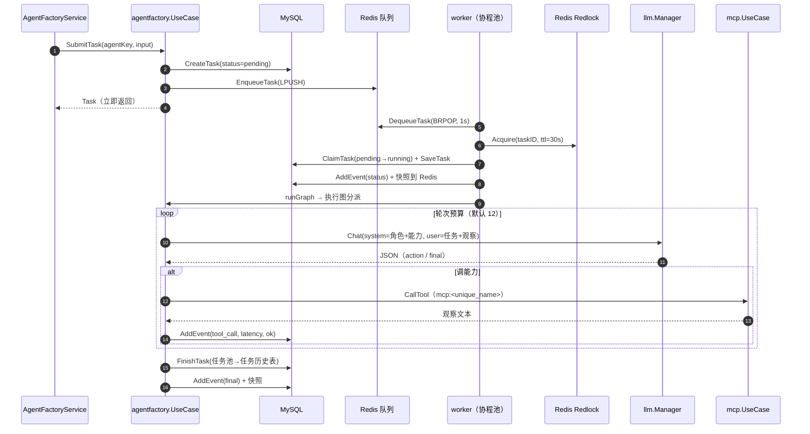

**（C）检索链路：文档入库 + 问答**

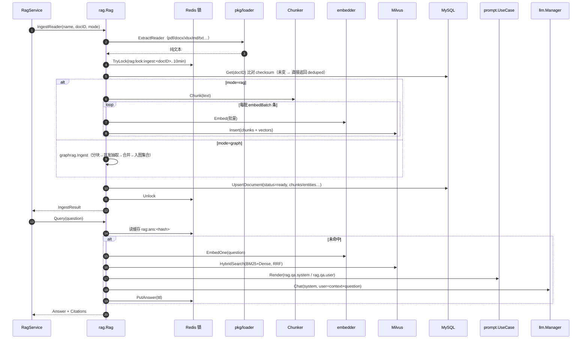

### 1.5 全局约定（违反这些约定 = 埋雷）

1. **protojson 零值省略**：新增 proto 字段必须是「默认值即旧行为」的语义，否则老前端会丢字段。
   biz 侧的 bool/int 判断要按「零值 = 未设置」写，例如 `if in.Enabled == nil { 默认 true }`（用指针）。
2. **写历史/写日志一律异步**：`history.Record`、`llm.Manager.record` 都是 `go func` + 5s 超时，
   失败只 `log.Warn`。**不要**把它们改成同步，否则一次 MySQL 抖动会拖慢整条问答链路。
3. **召回类能力 best-effort**：`conversation.recallContext` 里 Memory / RAG / GraphRAG 任一失败都只写
   `meta.*_error`，不阻断对话。新增召回能力时保持这个约定。
4. **上下文传身份，不改业务签名**：任务/会话身份通过 `history.WithTask` / `history.WithConv` /
   `llm.WithMeta` 放进 ctx，业务方法签名不动。这是本仓库最重要的解耦手段。
5. **分页**：`Limit` 缺省由 biz 兜底（会话 50、任务 50、事件 200、历史 100），越界上限由各模块 clamp，
   不要把前端传的 `limit` 直接塞进 SQL。
6. **错误语义**：每个模块定义哨兵错误（`ErrNotFound` / `ErrInvalidXxx` / `ErrXxxDeny`），
   service 层用 `errors.Is` 映射 HTTP 状态码。不要用字符串比较错误。
7. **时间**：统一 `time.Time`，落库 `created_at/updated_at`，对外由 service 转 RFC3339 字符串。
8. **测试**：biz 模块用 `fakeRepo`（手写，不引 mock 框架）。改接口后**必须**同步 fake，否则 `go test ./...` 直接编译失败——
   这是刻意的，用来强制你更新所有实现。

---

## 2. 模块交接明细

每个模块按同一模板写：定位 → 关键类型 → 端口实现 → 用例清单 → 时序图 → 存储落点 → 改动指南 → 坑 → 测试。

---

### 2.1 conversation（会话域）

**定位**：一条用户与平台的对话记录。两个能力叠在同一个包里：

- `conversation.go` + `chat.go`：会话目录 CRUD、消息追加、**LLM 自主编排**的一轮对话；
- `debate.go`：同一会话内的**多角色辩论**（后台 goroutine 推演，用户只做监督者）。

**文件**：`types.go`（领域模型/状态常量）、`conversation.go`（Repo 接口 + 目录用例）、`chat.go`（编排）、`debate.go`（辩论）。

#### 关键类型

| 类型 | 说明 | 易错点 |
| --- | --- | --- |
| `Conversation` | ID 可复用任务 ID（`会话 id = task id`），`HasDebate` 是目录分组派生字段 | 自己生成的 ID 形如 `c-<hex(unixnano)>-<4位随机>`；长度上限 64 |
| `Message` | `Speaker` 区分辩论角色/主持人（普通会话为空）；`Meta` 是本轮链路 JSON；`TaskID` 关联任务 | `Meta` 超过 8000 字会被**截断**，不要把大对象塞进去 |
| `Debate` | `Status` 五态、`Round/MaxRounds`、`EndRule`、`Roles` | 状态机见下 |
| `ChatDeps` | 5 个可选依赖（LLM/Rag/Memory/MCP/Agents），**nil 即跳过该能力** | 单测里可以只给 LLM，其余 nil |

**辩论状态机**：

```text
            CreateDebate
                 │
                 ▼
            [running] ──PauseDebate──▶ [paused] ──ResumeDebate──▶ [running]
                 │                        │
                 │                        └──StopDebate──┐
                 └──────StopDebate──────────────────────▶ [stopping]
                                                              │ 当前发言结束
                                                              ▼
                                             summarize ─▶ [stopped]
            [running] 跑满轮次 / consensus 判定收敛 ─▶ summarize ─▶ [finished]
```

#### 端口与实现

| 端口 | 实现 | 备注 |
| --- | --- | --- |
| `conversation.Repo` | `data/db/repo.ConversationRepo` | 12 个方法，含辩论 6 个 |
| `ChatDeps.LLM` | `*llm.Manager` | 辩论必须有它，缺失时 `CreateDebate` 直接报错 |
| `ChatDeps.Rag` / `Memory` / `MCP` / `Agents` | 各自 `*UseCase` | 由 `wire.Struct(new(ChatDeps), "*")` 注入 |

#### 用例清单

| 方法 | 语义 | 入口 |
| --- | --- | --- |
| `Create(ctx, id, title, agentKey)` | 新建（id 空则生成，可传任务 ID） | `POST /api/conversations` |
| `List` / `Get` / `Detail` | 目录（`updated_at` 倒序）/ 详情 / 详情+消息 | `GET /api/conversations[/{id}]` |
| `Rename` | 改标题 | `PUT /api/conversations/{id}` |
| `Delete` | 删会话（消息级联） | `DELETE /api/conversations/{id}` |
| `Append` / `AppendAs` | 追加消息（后者带 speaker） | `POST /api/conversations/{id}/messages` |
| `Chat` | 一轮完整对话 | `POST /api/conversations/{id}/chat` |
| `CreateDebate` / `CurrentDebate` | 开辩论 / 查当前（活跃优先，否则最近一场） | `POST .../debates`、`GET .../debates/current` |
| `PauseDebate` / `ResumeDebate` / `StopDebate` | 暂停 / 恢复 / 叫停 | `POST .../debates/current/pause|resume|stop` |
| `AddDebateRole` / `RemoveDebateRole` | 辩论中增减角色（下一轮生效） | `POST .../debates/current/roles[/remove]` |

#### 时序图 1：Chat 编排（内部细节版）

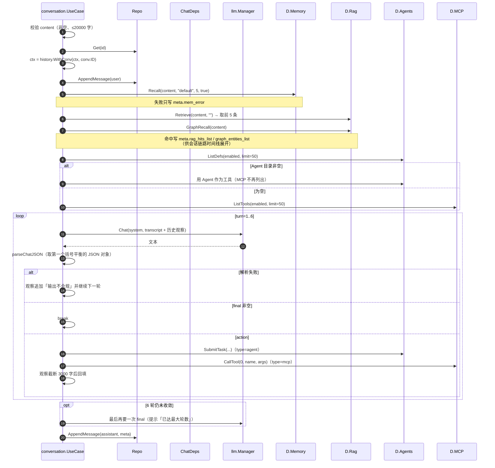

**关键常量**（改行为先看这里，位于 `chat.go` 顶部）：`chatMaxTurns=6`、`chatMaxHistory=20`、
`chatHistoryClip=800`、`chatObservationCl=3000`、`chatRagTopK=5`、`chatMemTopK=5`、`chatToolLimit=50`、
`agentWaitTimeout=5min`、`agentPollInterval=2s`、`recallDetailLimit=20`。

#### 时序图 2：辩论推演 + 暂停/恢复

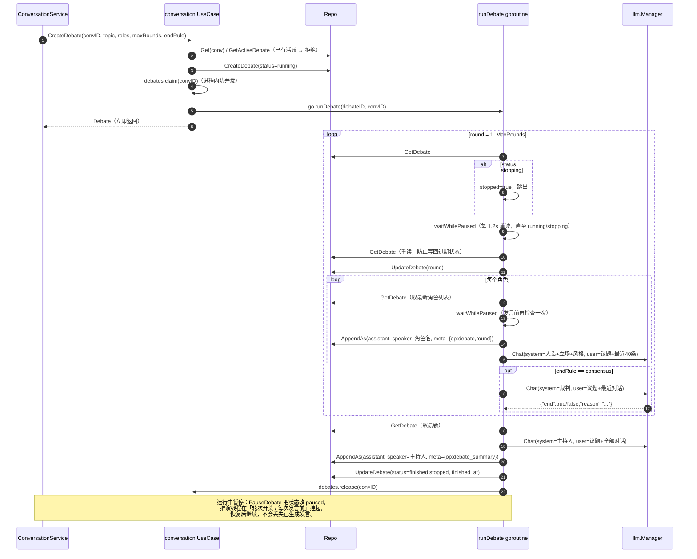

**启动恢复**：`NewUseCase` 会调用 `repo.StopOrphanDebates`，把上次进程重启时仍处于
`running/paused/stopping` 的辩论统一置为 `stopped`。**没有这步，会话会被永久占用、开不了新辩论**——
这是排障时最先怀疑的地方。

#### 存储落点

- `conversations`：ID、title、agent_key、message_count、last_message、时间戳。
- `conversation_messages`：role、speaker、content、meta（本轮链路 JSON）、task_id。
- `debates`：conversation_id、topic、status、round、max_rounds、end_rule、roles（JSON）、finished_at。
- 无 Redis / Milvus 依赖（`debateManager` 只是进程内 map）。

#### 改动指南

| 想做的事 | 改哪里 | 注意 |
| --- | --- | --- |
| 增加新的召回源（如联网搜索） | `chat.go: recallContext` + `chatSystem` 的上下文块 | 必须 best-effort，失败写 `meta.xxx_error`；同时把明细写进 `meta.xxx_list` 供链路时间线展开 |
| 支持新的工具类型（非 agent/mcp） | `chat.go: execAction` 的 switch | 未知类型目前返回错误字符串作为观察，不要让整个 Chat 失败 |
| 调整对话轮数/截断 | `chat.go` 顶部常量 | 调大 `chatMaxTurns` 会直接线性放大 token 成本 |
| 新增辩论结束规则 | `types.go` 常量 + `debate.go: runDebate` 判定分支 + `CreateDebate` 校验 | 前端与 proto 枚举需同步 |
| 辩论阶段进度（如「第 2/4 轮」） | 已有 `Round` 字段 + `meta.round` | 不要新建表 |

#### 坑

1. **`Append` 会先 `Get` 会话**：会话不存在时报 `ErrNotFound`，而不是外键错误——排查「消息插入失败」先看会话 ID。
2. **`Chat` 的 LLM 失败不返回 error**，而是落一条 `meta.ok=false` 的 assistant 消息（内容为「本轮执行失败：…」）。
   所以前端看「有回复但内容奇怪」时，去看 assistant 消息的 meta。
3. **Agent 委派是同步等待**：`execAction` 里 2s 轮询 `GetTask`，最长 5 分钟。长任务会把 HTTP 请求拖住，
   前端必须设置足够长的超时（当前前端是 5 分钟）。
4. **`toolCatalog` 是「二选一」**：Agent 目录非空就不列 MCP 工具。想让两者共存必须改这个函数。
5. **辩论 goroutine 用的是 `context.Background()`**，不受 HTTP 请求取消影响——只能通过 DB 状态（stopping/stopped）控制。
6. **暂停是「协作式」的**：`PauseDebate` 只改状态，当前这句发言会照常生成完；前端不要期待秒停。

#### 测试

- `conversation_test.go`：目录 CRUD + 参数校验（含「用任务 ID 建会话」）。
- `chat_test.go`：工具目录为空时的单轮直答、JSON 解析容错。
- 辩论没有单测（依赖 LLM），靠手动：建会话 → 建 2 角色辩论 → 暂停 → 恢复 → 叫停 → 查 `debates` 表状态。

---

### 2.2 agentfactory（Agent 工厂 + 任务执行）

**定位**：整个平台最重的模块。「Agent 是一份数据（`AgentDef`），不是代码」——定义存 MySQL、
向量存 Milvus、热缓存与任务队列在 Redis；任务由 worker 池异步执行，执行图决定推理策略，
事件流（`TaskEvent`）记录全过程供链路检索。

**文件分工**（接手时按这个顺序读）：

| 文件 | 内容 | 行数级别 |
| --- | --- | --- |
| `types.go` | 领域模型、12 种 `GraphType` 常量、状态常量、校验 | 大 |
| `agentfactory.go` | `UseCase` 主体：定义 CRUD、任务提交/取消/重试、worker 池、`executeTaskNow` | 大 |
| `runtime.go` | `Recorder`（事件/进度/快照）、`runGraph` 分派、`runToolLoop` 通用循环 | 中 |
| `graphs.go` | 各执行图实现（plan_execute / reflexion / router / self_ask / state_machine / orchestrator / debate / blackboard…） | 最大 |
| `graph.go` + `flow.go` | DAG 编排（`FlowGraph` 解析/校验/执行、条件分支） | 中 |
| `workflow.go` | 显式串行/并行成员编排 + 汇总 + 监察 | 中 |
| `capability.go` | 能力目录（Agent 委派 + MCP 工具 + 技能统一视图）、`InvokeDispatch` | 小 |
| `factory.go` | `create_agent` 元编程护栏（配额、白名单、防自举、沙箱灰度） | 中 |
| `cron.go` + `schedule.go` | 5 字段 cron 解析、定时调度器 | 小 |
| `roles.go` | 监察者（supervisor）/ 风险评审（risk）角色 | 中 |
| `ports.go` | `Repo` / `VectorStore` / `Cache` / `TaskLock` / `Chatter` / `Embedder` / `ToolPort` | 小 |

#### 关键类型

| 类型 | 说明 |
| --- | --- |
| `AgentDef` | `AgentKey`（唯一）、`System`、`Capabilities`（能力白名单）、`GraphType`、`MaxTurns`、`Flow`（DAG JSON）、`Members`（编排成员）、`Orchestration`（serial/parallel）、`Schedule`（cron）、`Source`（manual/llm）、`Sandbox`、`Vectorized` |
| `Task` | `Status`（pending/running/succeeded/failed/canceled）、`Progress`、`Result`、`ErrorMsg`、`ConvID`、`Archived` |
| `TaskEvent` | `Type`（status/thought/tool_call/delegate/final/error…）、`Turn`、`Payload`（JSON） |
| `Recorder` | 任务执行期的事件写入器：`event` / `status` / `snapshot` / `setProgress` |
| `CapabilitySchema` | 能力目录条目：`agent:<key>`、`mcp:<unique_name>`、`skill:<name>` |

**状态机（任务）**：

```text
SubmitTask → [pending] ──ClaimTask──▶ [running] ──成功──▶ [succeeded]
                 │                        │
                 │ CancelTask             ├──失败──▶ [failed]
                 ▼                        └──ctx 取消──▶ [canceled]
             [canceled]                   （终态统一 FinishTask：任务池 → 任务历史表）

RetryTask: 终态（历史表） ──ReviveTask（插池+删历史）──▶ [pending] ──入队──▶ …
```

#### 端口与实现

| 端口 | 实现 | 关键约束 |
| --- | --- | --- |
| `Repo` | `data/db/repo.AgentFactoryRepo` | `ClaimTask` 必须原子；`FinishTask`/`ReviveTask` 必须单事务（任务任一时刻只在一张表） |
| `VectorStore` | `milvusdb/repo.AgentStore`（`{base}_agents`） | 只存 id + 向量 + `enabled` 等标量 |
| `Cache` | `redis.AgentFactoryCache` | `af:agent:<id>` / `af:task:<id>`；任务快照只缓存活跃任务 |
| `TaskLock` | `redis.TaskLock` | SET NX PX + token 校验释放/续期；多节点 Quorum |
| `Chatter` | `*llm.Manager` | 通过 `llm.WithMeta` 关联 task/agent |
| `ToolPort` | `*mcp.UseCase` | 能力目录与调用入口 |
| `SkillPort` | `*skill.UseCase` | 技能目录（启用项）与 SKILL.md 读取 |
| `Embedder` | `*embedder.EmbeddingClient` | Agent 定义语义召回 |

#### 用例清单（按重要性）

| 方法 | 语义 |
| --- | --- |
| `ListDefs` / `GetDef` / `CreateDef` / `UpdateDef` / `DeleteDef` / `ToggleDef` | 定义 CRUD（写后推向量 + 失效缓存） |
| `SearchDefs(query, limit)` | 语义召回 Agent（Milvus → 缓存/DB 补全） |
| `SyncAllVectors` | 全量重建 Agent 向量（管理端修复用） |
| `Capabilities` | 能力目录（Agent 委派 + MCP 工具 + 技能统一 schema） |
| `SubmitTask` / `ListTasks` / `GetTask` / `TaskEvents` | 任务提交与查询 |
| `CancelTask` / `RetryTask` | 取消（pending 直接终态 / running 走 ctx cancel）/ 重试（历史表复活） |
| `Stats` | 定义数、各状态任务数、能力数 |
| `StartWorkers` / `Drain` / `Stop` | worker 池生命周期：`BeforeStart` 启动、`BeforeStop` 排空、`AfterStop` 硬停（见下节） |

#### 优雅停机（draining）

**要解决的问题**：worker 池在进程内消费 Redis 队列，进程一收到 `SIGTERM` 就退出的话，正在跑的任务会被腰斩，
LLM / 工具调用半途中断、事件链条断在中间。目标是「**不再领新任务，但把手上这单做完**」。

**三个入口（`cmd/go_agent/main.go` 的 `newApp`）**：

| 生命周期 | 调用 | 语义 |
| --- | --- | --- |
| `BeforeStart` | `StartWorkers()` | 恢复中断任务 + 起 worker 池 + cron 调度器 |
| `BeforeStop` | `Drain(ctx)` | 置 `draining`、关闭 `drainCh`、等执行中任务结束；**此时 HTTP 还在服务** |
| `AfterStop` | `Stop()` | 兜底硬停：取消 `workerCtx`、等待全部协程退出 |

**实现要点**（`agentfactory.go`）：

```go
draining  atomic.Bool      // 置位后 SubmitTask 直接拒（ErrShuttingDown）、worker 不再领新任务
drainCh   chan struct{}    // close 之后，阻塞在 DequeueTask 上的 worker 立刻被唤醒退出
wg        sync.WaitGroup   // 全部后台协程（worker + cron 调度器）
workerWG  sync.WaitGroup   // 只管 worker —— Drain 只等这一组
inFlight  atomic.Int64     // 仅用于停机日志（"还在跑几个"）
```

- **必须先出队再执行**：`workerLoop` 从 `DequeueTask` 拿到 id 就把消息消费掉了，跳过不跑会留下孤儿任务，
  所以领任务与 `draining` 检查的顺序是「先检查、再出队、出队即跑」。
- **等待上限取小值**：`min(agentfactory.shutdownTimeout, ctx 剩余时间)`。Kratos 的 `BeforeStop` ctx 通常带
  编排层给的 deadline，取小值避免排空把进程拖过 kill 期限。
- **只等 worker，不等 cron**：调度器随 `workerCtx` 取消退出，若算进等待组会白等满整个超时（踩过这个坑）。
- **幂等**：`drainOnce` 保证重复调用只执行一次；`workerCtx == nil`（worker 未启动）直接返回。
- **两个日志分支**（排障认这两句）：

  ```text
  优雅停机完成：执行中的任务已全部结束                     ← 正常排空
  优雅停机等待超时，强制中断执行中的任务（下次启动会自动重跑，不会丢任务）  ← 走 Stop()
  ```

**超时被打断的任务是什么状态**：**保持 `running`，不写终态**。不能标 `canceled`（用户没取消），
也不能标 `failed`（不是任务本身失败）。下次启动 `StartWorkers` → `RequeueInterrupted` 把它重新入队，
从头执行（`executeTaskNow` 会重建事件链，历史事件保留可追溯）。

**配置**：`data.agentfactory.shutdownTimeout`（默认 20s），要**小于**编排层 kill 期限
（k8s `terminationGracePeriodSeconds` 默认 30s），给进程退出和日志落盘留余量。

**测试**（`agentfactory_test.go`）：`TestDrainWaitsForInFlightTask`（等在跑的任务）、
`TestDrainRejectsNewTasks`（排空期间提交返 `ErrShuttingDown`）、
`TestDrainTimeoutKeepsTaskRunning`（超时后任务仍 `running` 且未写 `finished_at`）。

#### 时序图 1：SubmitTask → worker → 执行图

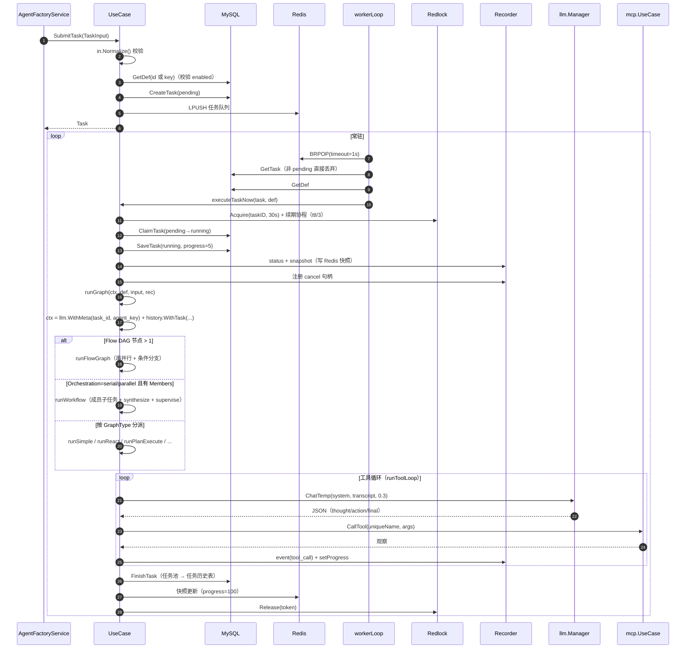

#### 时序图 2：崩溃恢复与重试

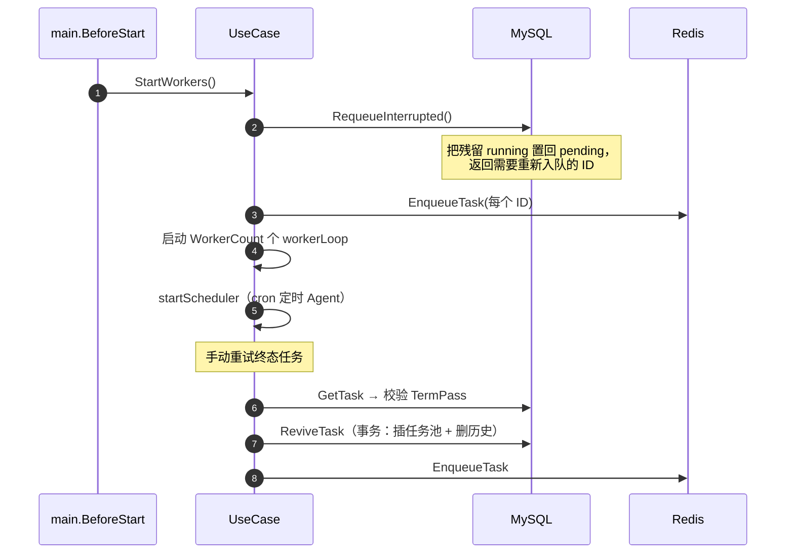

#### 存储落点

| 存储 | 键/表 | 内容 |
| --- | --- | --- |
| MySQL | `agent_definitions` | 定义全字段（`flow`/`members`/`capabilities` 为 JSON） |
| MySQL | `agent_tasks` | **仅活跃任务**（pending/running） |
| MySQL | `agent_task_history` | 终态任务（succeeded/failed/canceled），与任务池互斥 |
| MySQL | `agent_task_events` | trace 事件流 |
| Milvus | `{base}_agents` | 定义向量（语义召回） |
| Redis | `af:agent:<id>` | 定义热缓存 |
| Redis | `af:task:<id>` | 活跃任务快照（前端轮询实时性） |
| Redis | `af:lock:task:<id>` | Redlock |
| Redis | 任务队列 List | `LPUSH` / `BRPOP` |

#### 改动指南

| 想做的事 | 改哪里 | 注意 |
| --- | --- | --- |
| 新增一种执行图 | `types.go` 加常量 + `GraphTypes` + `runtime.go: runGraph` 分支 + `graphs.go` 实现 | 必须能被 `ValidGraphType` 认可，否则 `CreateDef` 校验失败；新图要复用 `runToolLoop` 以保持工具/错误行为一致 |
| 新增 Agent 能力（capability） | `capability.go: Catalog.Schemas` + `InvokeDispatch` | 能力名要加前缀（`mcp:` / `agent:`），否则前端无法区分 |
| 改 prompt 结构 | `runtime.go: buildSystemPrompt` | 会影响所有执行图，改动前跑 `graph*_test.go` |
| 增加任务字段 | proto + `db/models/agentfactory.go` + `repo` + `types.go` | 任务表与历史表**两张都要加** |
| 调整并发/配额 | `data.go: NewAgentFactoryOptions`（读 conf `data.agentfactory`） | `WorkerCount` 改大要考虑 MySQL 连接池 |
| 定时任务行为 | `schedule.go: tickOneSchedule` + `cron.go` | 调度锁用 `scheduleLockBase | defID`，与任务锁共用 TaskLock |

#### 坑

1. **两张任务表**：任何新写的查询都要想清楚「查活跃还是查历史」。`ListTasks` 由 repo 合并两表，
   但直接写 SQL 的人容易漏。
2. **`GetTask` 先读 Redis 快照**：快照是「活跃任务」的，终态任务读库。若快照残留（异常退出）会读到旧状态，
   `FinishTask` 后必须让快照同步更新（`rec.snapshot()` 已处理）。
3. **Redlock 拿不到不是失败**：`ErrTaskLockBusy` 表示别的 worker 正在跑，`claimAndRun` 会静默返回。
   排障时不要把它当错误。
4. **子任务共享父任务 trace 还是独立**：`runChildTask` 会创建子任务（独立 ID、独立事件流），
   父任务的 `delegate` 事件里记录子任务 ID。链路查询要按这个关系串。
5. **「指定模型」仍是提示词前缀，「指定数据源」是真实现**：`def.LLMModel` 只在 system 前加
   `[期望模型: xxx]`；而 `def.LLMSource`（Agent 默认模型数据源）走 `Chatter.ChatSource` →
   `llm.Manager.ChatSource`：命中启用源优先调用，未命中或调用失败回退默认链路
   （default 优先 → 其他启用源 → conf 兜底）。按「模型」选源仍需改 `candidates`。
6. **`Progress` 是估算值**：`90/maxTurns` 递增，不代表真实完成度；前端不要做精确进度条。
7. **cron 是进程内调度**：多副本部署会重复触发，靠 `scheduleLock` 兜底；单副本无需担心。

#### 测试

- `agentfactory_test.go`：定义 CRUD、任务状态流转（用 fakeRepo/fakeCache）。
- `graph_test.go` / `graphs_test.go`：DAG 解析、条件分支、各执行图骨架。
- `workflow_test.go`：串行/并行成员、汇总。
- `cron_test.go`：5 字段解析与 `Next`。
- 改动执行图后**必须**跑 `go test ./internal/biz/agentfactory/...`（5 个测试文件、1600+ 行，是最可靠的回归网）。

---

### 2.3 harness（评测 Harness）

> ⚠️ **当前状态：未接线**。包内自洽可编译可单测，但没有 proto / service / data repo 实现，
> 也没有出现在 `biz.go` 或 `data.go` 的 ProviderSet 里。接手第一件事见 5.1。

**定位**：把「这个 Agent / 模型到底行不行」变成可重复的自动化评测。核心是**黑盒**：
harness 不关心被测对象内部怎么跑，只管「给输入 → 拿输出 → 按规则判分」。

**文件**：`doc.go`（包说明）、`types.go`（模型 + 断言校验 + 加权算分）、`ports.go`（Repo/Runner/Chatter）、
`harness.go`（用例集/用例/运行编排）、`judge.go`（规则断言 + LLM-as-Judge）、`设计方案.md`（设计取舍）。

#### 关键类型

| 类型 | 说明 |
| --- | --- |
| `Set` | 用例集 = 一个被测对象的一组用例（调度单位），`Target` 默认被测对象 |
| `Case` | `Input` + `Context`（前置上下文）+ `Expect`（参考答案）+ `Checks`（断言）+ `Tags` |
| `Check` | `Kind`（7 类）+ `Pattern` + `Weight`（0 按 1 计） |
| `Run` | 一次运行：`Total/Done/Passed/Failed/Errored/Score/CostMS`，进度实时落库供轮询 |
| `RunItem` | 单用例结果：`Output`、`Checks []CheckResult`、`Score`、`LatencyMS`、token 用量 |

**被测对象前缀**：`agent:<agent_key>`（走 agentfactory 同步执行，复用执行图与能力白名单，trace/LLM 记录自动关联）、
`model:<模型名>`（走 llm.Manager 直连，做模型横评）。

**7 类断言**：`contains` / `not_contains` / `regex` / `json_valid` / `min_length` / `max_length` / `llm_judge`。
`Score` 是加权平均（0-100）；**没有断言（权重全 0）返回 -1 = 不判分**，报告里要区别对待「0 分」和「未判分」。

#### 端口与实现

| 端口 | 设计上的实现 | 现状 |
| --- | --- | --- |
| `Repo` | `data/db/repo.HarnessRepo`（sets/cases/runs/run_items 四表） | **未实现** |
| `Runner` | data 层适配器：`agent:` → `agentfactory.UseCase`，`model:` → `llm.Manager` | **未实现** |
| `Chatter` | `*llm.Manager`（LLM Judge） | 可直接绑定 |

#### 时序图：StartRun → 并发执行 → 报告

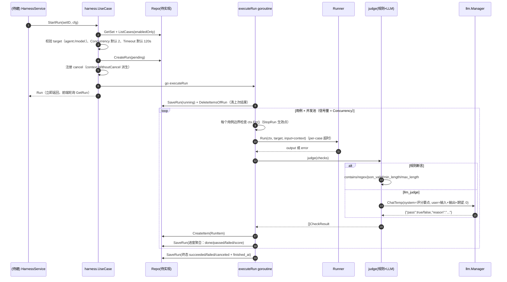

#### 改动指南 / 坑

- **接线顺序**：proto（`api/harness/v1`）→ `dbrepo.NewHarnessRepo`（四张表）→ `Runner` 适配器
  （`agent:` 走 `SubmitTask` + 轮询，或新增同步执行入口；`model:` 走 `llm.Manager.ChatWith`）→
  `biz.go` 加 `harness.New` → `data.go` 加 repo/runner/Bind → `service/harness_service.go`。
- **不要在 harness 里直接调 `agentfactory` 内部方法**：`Runner` 端口存在的意义就是隔离；
  否则以后想评测外部系统（HTTP Agent、竞品 API）要动 biz 核心。
- **`StopRun` 是协作式的**：只设置 ctx 取消，正在跑的用例会执行完（可能 120s）。前端要有「停止中」态。
- **`Errored` 不计入判分分母**：执行报错的用例只记 `RunItem.Error`，不当作 0 分，否则评测结果会误导。
- **LLM Judge 的温度必须为 0**：`judge.go` 里已固定；自己加断言类型时别引入随机性。
- **测试**：`harness_test.go` 用 fake Repo/Runner 覆盖「加权算分、无断言 -1、取消边界、错误不计分」。

---

### 2.4 memory（记忆系统）

**定位**：三层记忆，各司其职。

| 层 | 存储 | 用途 | 生命周期 |
| --- | --- | --- | --- |
| 短期 | Redis List `mem:short:<sessionID>` | 多轮对话上下文 | TTL（默认 24h，写入续期） |
| 长期 | MySQL `memories` + Milvus `{base}_memories` | 事实/偏好/事件/洞察/待办 | 永不过期或指定 `expires_at` |
| 图谱 | Milvus `{base}_graph_entities/_relations`（**与 RAG 共用**） | 记忆间、记忆与文档间的实体关系推理 | 随记忆删除清理孤儿节点 |

**文件**：`types.go`（模型/常量）、`memory.go`（用例主体）、`detail.go`（召回明细 JSON，供 `op_histories.detail`）、`ports.go`。

#### 用例清单

| 方法 | 语义 | 入口 |
| --- | --- | --- |
| `Remember(in)` | 写长期记忆：去重 → 向量 → MySQL → 图谱 | `POST /api/memory/long` |
| `Recall(query, userID, topK, withGraph)` | 向量召回 + 过期过滤 + 图谱 2 跳扩展 | `POST /api/memory/recall` |
| `Answer(sessionID, userID, question)` | 短期历史 + 长期召回 → LLM 生成 → 写回短期 | `POST /api/memory/answer` |
| `AppendMessage` / `History` / `ClearSession` / `SessionLen` | 短期记忆读写 | `/api/memory/short` |
| `Get` / `List` / `Delete` | 长期记忆管理（删除同时清向量 + 图谱孤儿） | `/api/memory/long[/{id}]` |
| `PurgeExpired(limit)` | 批量清理过期记忆 | `POST /api/memory/long/purge` |
| `Stats` / `Info` | 规模 + 运行参数 | `/api/memory/long/stats`、`/api/memory/info` |

#### 时序图 1：Remember（写路径）

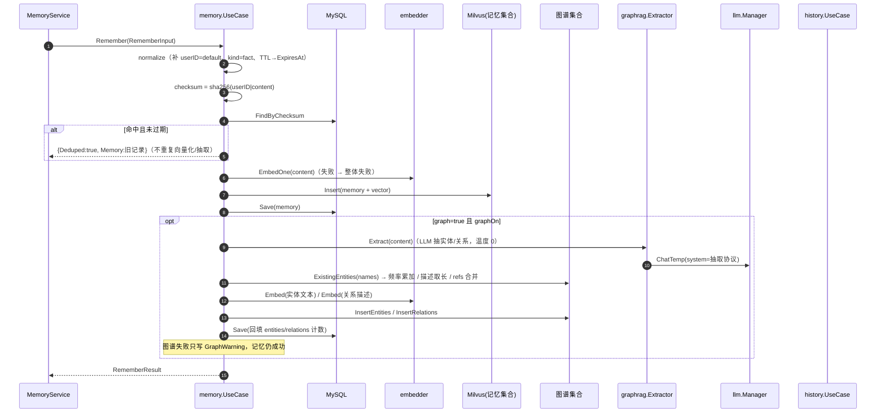

#### 时序图 2：Recall（读路径 + 历史记录）

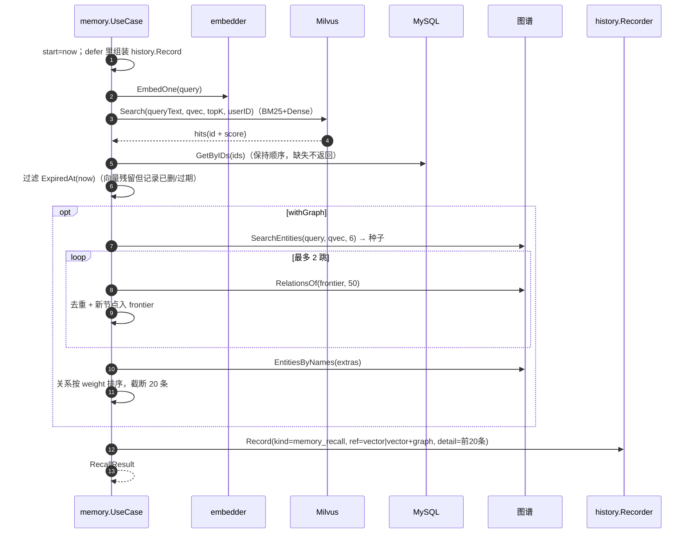

#### 存储落点与关键参数

- MySQL `memories`：`id`(string) / `user_id` / `kind` / `content` / `importance`(1-5) / `tags` / `source` /
  `checksum` / `expires_at` / `entities` / `relations`。
- Redis：`mem:short:<sessionID>`（List，`Append` 时续期 `shortTTL`）。
- 配置（`data.memory`）：`shortTTL`(24h)、`recallTopK`(8)、`historyLimit`(20)、
  `graphEnabled`、`graphMaxEntities`(8)、`graphMaxRelations`(6)。
- 召回明细：`detail.go: buildRecallDetail` 最多 20 条、正文截 240 字——**这是前端「召回明细」展开的数据源**。

#### 改动指南 / 坑

- **`Remember` 的失败语义是「向量写成功、MySQL 写失败」会留下孤儿向量**。目前靠 `Recall` 的
  「查不到 MySQL 就跳过」兜底。要彻底解决，需加补偿任务或先写 MySQL 再写向量。
- **去重是内容级**：同用户同内容（checksum 相同）且未过期 → 直接返回旧记录，**不会更新 importance/tags**。
  想「记住了但想改重要性」必须换内容或先删。
- **图谱与 RAG 共用集合**：记忆的 `chunk_refs` 形如 `mem::{user}::{memoryID}#0`，文档的是 `<docID>#<idx>`。
  删除记忆时调 `DeleteByMemory` / `DetachDocRefs` 清理，**不要**直接删 Milvus 行。
  `DetachDocRefs` 会删掉只属于该来源的节点，并把共享节点上的这份引用摘掉（改写 refs/freq）。
- **`Recall` 的 `query` 会拼进 `history.Record.Query`（`query + "@" + userID`）**，改这里要同步前端解析逻辑。
- `New` 启动即 `EnsureCollection`（120s 超时）：Milvus 没起来服务会**启动失败**，这是刻意的快速失败。

#### 测试

`memory_test.go`：去重、过期过滤、图谱开关、`PurgeExpired` 计数（fake 三存储）。

---

### 2.5 rag（检索增强）+ graphrag（图谱线路）

> 详细设计见 `biz/rag/DESIGN.md` 与 `biz/rag/graphrag/DESIGN.md`（含 Milvus 字段级表结构）。
> 本节只写交接必须知道的：链路、边界、改动点、坑。

**定位**：两条并行业务线，靠 `mode` 分流。

| 线路 | mode | 构建 | 检索 |
| --- | --- | --- | --- |
| 向量 RAG | `rag`（默认） | 分块 → 批量 embedding → Milvus `{base}` | BM25 + Dense 混合（RRF），topK 默认 10，送 LLM 取前 topN 5 |
| GraphRAG | `graph` | 分块 → 并发 LLM 抽取实体/关系（信号量 4）→ 同文档合并 → 跨文档合并 → 入图集合 | 实体混合检索 → 关系多跳（默认 2 跳）→ 子图 + 原文证据 → LLM |

**文件**：`rag.go`（用例主体）、`chunker.go`（分块）、`detail.go`（召回明细）、`ports.go`；
`graphrag/service.go`（摄取/问答）、`graphrag/extractor.go`（LLM 抽取）、`graphrag/types.go`。

#### 用例清单

| 方法 | 语义 | 入口 |
| --- | --- | --- |
| `Ingest(docID, source, mode, text)` | 入库（加锁 + checksum 去重 + 分流） | `POST /api/ingest`、`POST /api/graph/ingest` |
| `IngestFile` / `IngestReader` | 先解析文件再入库 | `POST /api/upload` |
| `ExtractText` | 只解析不入库（前端预览/编辑） | `POST /api/extract` |
| `Query(question, filter)` | 缓存 → 检索 → 提示词 → LLM | `POST /api/query` |
| `Retrieve(question, filter)` | 纯检索（不生成），供会话注入 | 会话内部调用 |
| `GraphQuery` / `GraphRecall` | 图谱问答（带缓存）/ 只召回不生成 | `POST /api/graph/query`、会话内部 |
| `ListDocs` / `DeleteDoc` / `Stats` / `Info` / `Formats` | 文档管理 | `/api/docs`、`/api/stats`、`/api/formats` |

#### 时序图 1：Ingest 分流与失败落库

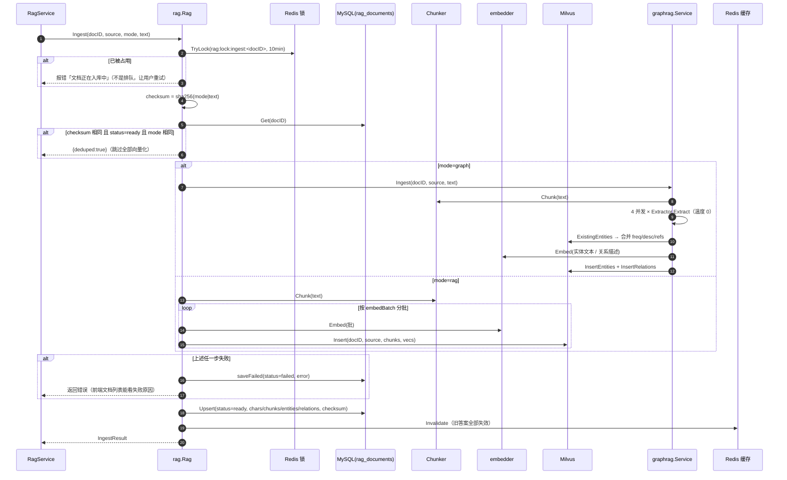

#### 时序图 2：GraphRecall（会话最常走的那条）

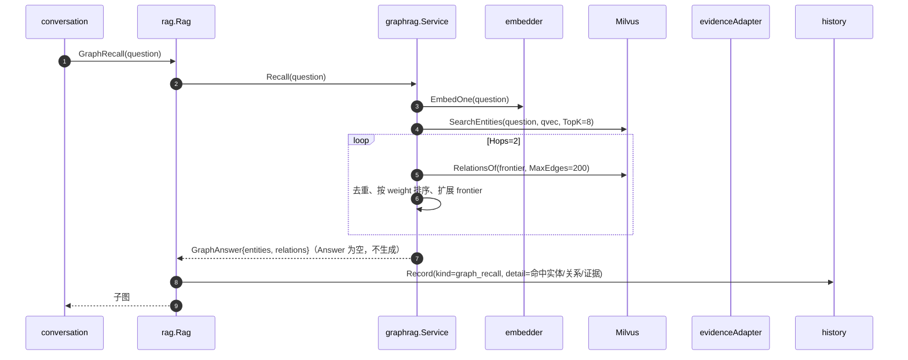

#### 存储落点

| 存储 | 位置 | 内容 |
| --- | --- | --- |
| MySQL | `rag_documents` | doc_id / source / mode / status / chars / chunks / entities / relations / checksum |
| Milvus | `{base}` | 文档块 + `sparse`(BM25) + `dense`；标量 `doc_id`/`source`/`chunk_idx` |
| Milvus | `{base}_graph_entities` / `_graph_relations` | 实体（name/type/description/freq/chunk_refs/source+双向量）/ 关系（source/target/relation/description/weight/chunk_refs/dense） |
| Redis | `rag:ans:<sha256(question\|filter) 前 12 字节的 hex>` | 问答缓存（TTL `cacheTTL`，缺省 5 分钟）；`Invalidate` 用 SCAN 前缀清空 |
| Redis | `rag:lock:ingest:<docID>` | 入库互斥锁（10 分钟） |

#### 改动指南 / 坑

- **`mode` 切换会自动清理对面产物**：`rag → graph` 时删旧分块（`DeleteDoc`），
  `graph → rag` 时摘旧图谱引用（`DeleteDocGraph`），不需要先手工 `DeleteDoc`。
- **同一 `docID` 重复入库**：`Ingest` 先记旧分块主键、写新版本、再按主键删旧版本，
  结果里的 `purged` 就是这次顶掉的行数；图谱侧由 `graphrag.Service.Ingest` 内的
  `DetachDocRefs` 摘掉旧引用。
- **`DeleteDoc` 的顺序**：先删分块 → 删图谱孤儿 → 删元数据 → 清缓存。图谱失败只写 `graph_warning`，
  不像分块失败那样中断。
- **`Query` 缓存键含 filter**：不同 filter 是不同缓存条目；`Invalidate` 是全清（简单粗暴，代价可接受）。
- **提示词热更新**：`Render(prompt.KeyRAGSystem/KeyRAGUser)` 走 `prompt` 的缓存 → DB → 内置三级回落。
  改词不用重启；但改**变量名**必须同时改 `rag.go` 里传的 `vars`。
- **GraphRAG 抽取是并发的（4）**：大文档会打满 LLM 配额，`MaxEntities/MaxRelations` 是每块上限，
  不是全局上限。
- **`evidenceAdapter`** 是 rag 为了让 graphrag 能回查原文而实现的适配器（`ChunkStore.GetTexts` 按
  `docID#idx` 取回）——这是唯一允许 graphrag 反向依赖 rag 的地方（接口在 graphrag 定义）。
- **`Reload` 语义**：Milvus 集合残缺（有集合无索引）时 `EnsureCollection` 会自愈补索引，
  这是启动慢的一个常见原因（要等索引构建）。

#### 测试

`rag_test.go`（入库分流/去重/删除/统计，fake 三存储）、`chunker_test.go`（分块边界）。
GraphRAG 无单测，靠端到端：`/api/graph/ingest` → `/api/graph/query`。

---

### 2.6 prompt（提示词工程）

**定位**：把提示词从代码里搬出来，做成**版本只增不改**的模板：任一时刻只有一个生效版本，回滚 = 把指针指回去。
RAG / GraphRAG / Memory / Agent 全部按 key 取当前生效版本，改词即时生效、不用重启。

**文件**：`types.go`（模型/内置 key/错误）、`prompt.go`（用例）、`template.go`（`{{var}}` 渲染与占位符提取）、
`builtin.go`（8 个内置模板原文）、`ports.go`。

#### 关键类型与内置 key

| 常量 | key | 用途 |
| --- | --- | --- |
| `KeyRAGSystem` / `KeyRAGUser` | `rag.qa.system` / `rag.qa.user` | 向量 RAG 问答 |
| `KeyGraphSystem` / `KeyGraphUser` | `graph.answer.system` / `graph.answer.user` | 图谱问答 |
| `KeyExtractSystem` / `KeyExtractUser` | `graph.extract.system` / `graph.extract.user` | 实体关系抽取 |
| `KeyMemorySystem` / `KeyMemoryUser` | `memory.answer.system` / `memory.answer.user` | 记忆问答 |

内置模板**不可删除**（`ErrBuiltinProtected`），但可以改、可以 `Reset` 用内置原文发一个新版本。
`Publish` 是「加版本 + 可选激活」，`Activate` 是「切指针」，`Rollback` 是「切到上一个版本」。

#### 时序图：Render 的三级回落（这是全模块最重要的行为）

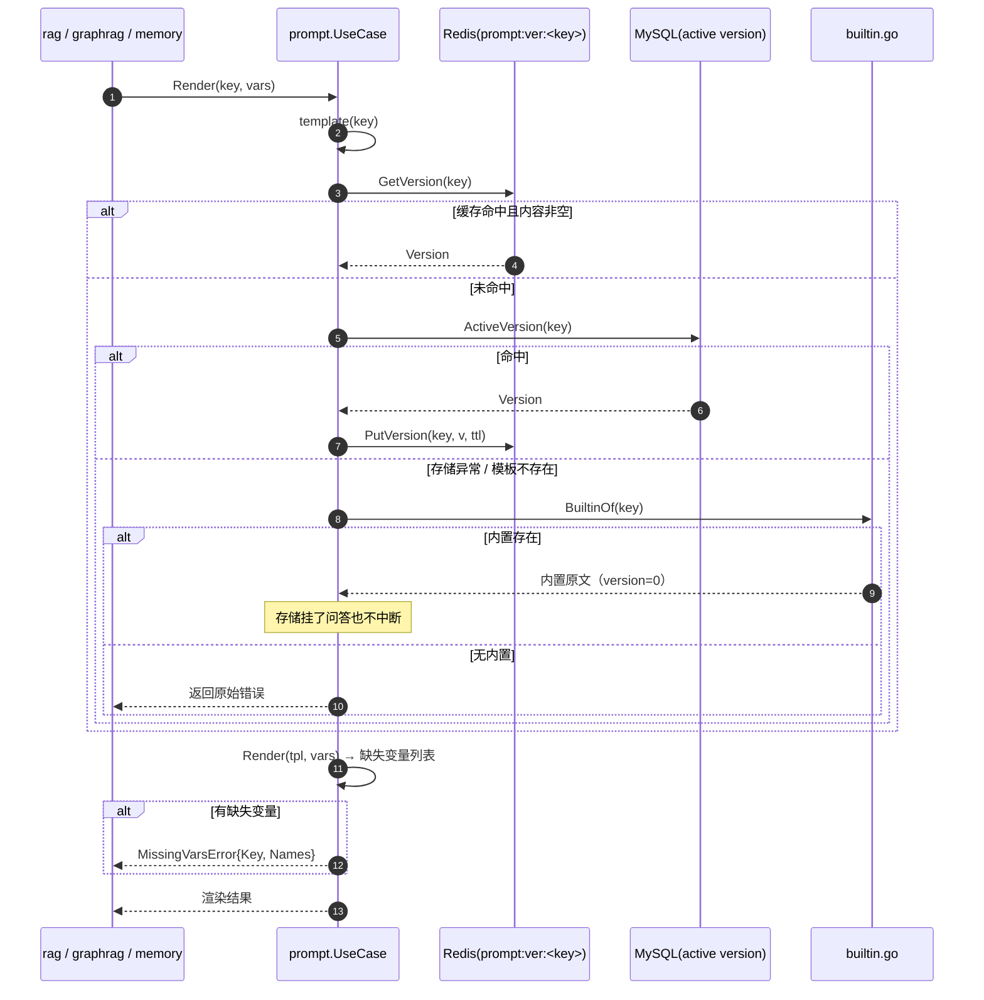

#### 存储与失效

- MySQL `prompt_templates`（元信息 + active_version）、`prompt_versions`（内容快照，只增不改）。
- Redis `prompt:ver:<key>`：缓存**已解析的生效版本**。TTL 取自 `data.prompt.cacheTTL`（默认配置 60s）；
  **配成 0 就是完全不缓存**（`template()` 里 `if u.ttl > 0` 才回填），此时每次渲染都读 MySQL。
- **任何写操作（Publish/Activate/Rollback/Reset/Delete/Update）都必须 `invalidate`**，
  否则线上会继续用旧提示词。这是本模块最容易漏的一步。

#### 改动指南 / 坑

- **新增内置模板**：`builtin.go` 的 `Builtins` 加一条（key 必须符合 `^[A-Za-z][A-Za-z0-9_.\-]{0,127}$`），
  启动时 `seed` 会写入 DB（已存在则跳过）。业务代码引用 `types.go` 里的常量，不要手写字符串。
- **`Render` 缺变量直接报错**，`Preview` 缺变量只列出（给前端调试）。别把 Preview 用在线上链路。
- **变量名区分大小写**，且只识别 `{{ name }}` 形式（不支持默认值、条件、循环）。
- **`Temperature` 存在 Version 上**：RAG 用 `Chat`（默认温度），GraphRAG 抽取用 `ChatTemp(0)`；
  改模板温度不会自动影响调用方，需要调用方按 `Version.Temperature` 传。
- **测试**：`prompt_test.go`（版本生命周期、内置保护、回滚）、`template_test.go`（占位符、缺失变量）。

---

### 2.7 mcp（MCP 服务与工具）

**定位**：把外部 MCP Server 的工具接进平台。一个 `Server` 1:N `Tool`；工具既是 Agent 的能力，
也是会话 LLM 可直接调用的工具。核心难点是**运行时实例管理**（连上/断开/复用）和**三存储一致性**（MySQL / Milvus / Redis）。

**文件**：`types.go`（模型/错误/传输常量）、`mcp.go`（用例，893 行）、`manager.go`（内存实例池）、`ports.go`。

#### 关键类型

| 类型 | 说明 |
| --- | --- |
| `Server` | `Transport` = `stdio` / `http`；http 有 `Endpoint`/`Headers`，stdio 有 `Command`/`Args`/`Env`；`Namespace` 用于分组过滤 |
| `Tool` | `UniqueName` = `<namespace>__<tool>`（超长截断优先保留工具名）；`Enabled`、`Vectorized`、`Schema`、`Annotations` |
| `Status` | 运行态：`Running`、`LastPingAt`、`LastSyncAt`、`ToolCount`、`ErrorMsg`、`HTTPClient` 描述 |
| `Manager` | 进程内 `map[serverID]*instance`；`Ensure` 按配置指纹复用，配置变了重连 |

#### 端口与实现

| 端口 | 实现 | 说明 |
| --- | --- | --- |
| `Repo` | `data/db/repo.MCPRepo` | `UpsertTools` 是**差异同步**：新增/变更才写，远端消失的软删 |
| `VectorStore` | `milvusdb/repo.ToolStore`（`{base}_tools`） | 只存 tool_id + 向量 + `server_id`/`namespace`/`is_enabled` 标量 |
| `Cache` | `redis.MCPCache` | `mcp:tool:<id>`、`mcp:status:<serverID>`、`ns:tools:<ns>`（Set） |
| `Dialer` / `ClientProvider` | `data/third_service/mcpclient` | 按 transport 建连；http 的 `*http.Client` 运行时注入不落库 |
| `Embedder` | `*embedder.EmbeddingClient` | 工具语义召回 |

#### 时序图 1：SyncTools（三存储一致性最容易出问题的地方）

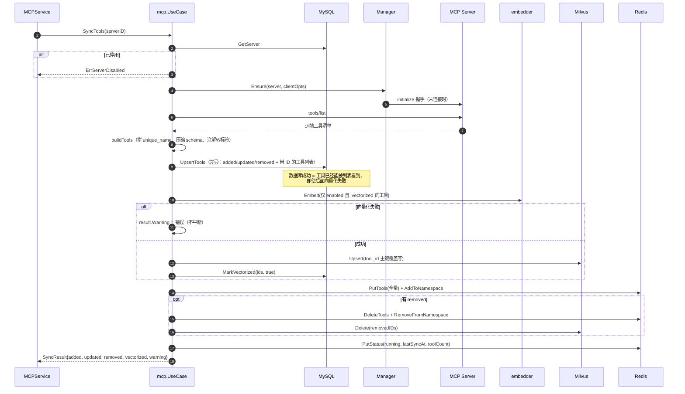

#### 时序图 2：SearchTools 与 CallTool

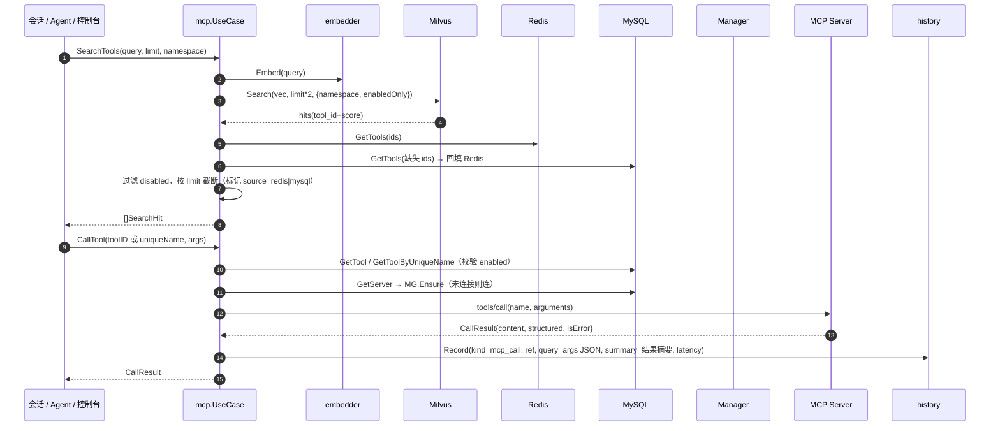

#### 改动指南 / 坑

- **同步是「尽力而为」的**：`SyncResult.Warning` 非空表示「元数据成功、向量失败」，此时工具能出现在列表里
  但**搜不到**（`Vectorized=false`）。修复手段：再点一次同步（只会向量化未标记的）。
- **`unique_name` 是全局唯一键**：改 `uniqueToolName` 的拼接规则会导致历史数据与新数据不匹配，
  必须同时提供迁移。
- **运行时实例不持久**：进程重启后 `Manager` 为空，第一次 `ListTools/SyncTools/CallTool` 会懒连接。
  所以「重启后状态显示未连接」是正常的，点一次「探活」即可。
- **`SetClientOptions` 只改内存**：超时/代理/TLS 参数不落库，重启回默认。要持久化得加表字段。
- **`SetToolEnabled` 必须同步 Milvus 标量**，否则向量过滤（`enabledOnly`）与 MySQL 状态不一致，
  会出现「已停用但仍被召回」。
- **stdio 模式的子进程**由 `Manager.Disconnect/CloseAll` 结束；`main` 退出时会调 `CloseAll`，
  自己写新入口时别忘。
- **无单测**：改动后必须手工回归——建 http server → 同步 → 搜工具 → 调工具 → 停用工具 → 再搜（应搜不到）。

---

### 2.8 llm（多数据源 + 场景路由）

**定位**：平台所有模型调用的唯一出口。既实现 `rag.Chatter` / `graphrag.Chatter` / `agentfactory.Chatter`，
又提供数据源的在线管理（增删改、启停、设默认、连通性测试、拉模型列表）和调用历史。

**文件**：`llm.go`（`Client`：OpenAI 兼容 `/chat/completions`，含 `usage`）、`manager.go`（多源路由 + 记录）、
`types.go`（`Provider`/`CallRecord`/`CallMeta`）、`ports.go`。

#### 关键行为

1. **候选排序**：`default` 优先 → `Priority` 降序 → `Name` 升序；只保留 `enabled && model && base_url` 齐全的。
2. **场景路由**：`ServesScene(scene)` 命中的排前面，**不命中的追加在后面做兜底**（不是排除）。
   场景：`rag` / `graph` / `extract` / `memory` / `general`。
3. **故障切换**：按候选顺序逐个试，任一成功即返回；全失败则用 `conf` 里的兜底 `Client`（名为 `fallback`）。
4. **快照缓存**：`snapshot` 带 TTL（默认 30s），增删改后必须 `Invalidate()` 才能立即生效。
5. **调用记录**：每次调用（含失败、含 fallback）异步写 `llm_calls`，记录 prompt/reply 截断文本、`usage`、
   耗时、`task_id`/`agent_key`/`purpose`。

#### 时序图：一次 Chat 的完整路径

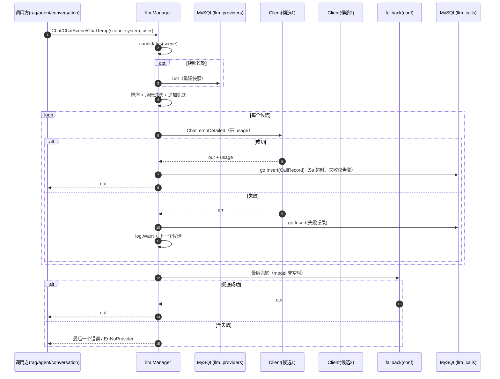

#### 改动指南 / 坑

- **改完配置一定要 `Invalidate()`**：`CreateProvider`/`UpdateProvider`/`DeleteProvider`/`SetDefault`/
  `SetEnabled` 内部已调用；自己加新的写方法别忘了。
- **`api_key` 脱敏**：`ListProviders`/`GetProvider` 返回的是脱敏副本；`UpdateProvider` 传空字符串
  = 「保持原值」，要清空得传特殊值（见 `applyPatch`）。
- **`DeleteProvider` 删默认源会自动把优先级最高的启用源设为默认**；没有可选源时允许删空（后续走 fallback）。
- **`CallMeta` 用 `llm.WithMeta` 覆盖式写入**：子任务各自覆盖自己的，不会串。
  但注意它是**独立 ctx key**，与 `history.WithTask` 互不影响。
- **记录里的 prompt 是「system + user 拼接后截断」**：`PromptFull`；字符数记截断前全量。
  前端 LLM 调用详情看到的「输入」就是它。
- **`Model()` 返回候选第一名**，不是「当前实际用的」；要看真实调用请查 `llm_calls`。
- **测试**：`manager_test.go`（候选排序/场景/兜底/记录）、`llm_test.go`（客户端响应解析与错误提示）。

---

### 2.9 skill（技能管理）

**定位**：技能 = `SKILL.md` + 若干文本文件。存 MySQL，可在线启停，可从技能市场（skillhub）搜索下载，
启用后可**落盘**到 `sync_dir` 供运行时读取。

**文件**：`skill.go`（668 行）、`types.go`、`ports.go`。

#### 用例清单

| 方法 | 语义 |
| --- | --- |
| `Install(in)` | 手动安装/上传；同名视为升级（按 `Enabled` 入参决定启停） |
| `Enable` / `Disable` | 启停 + 落盘/移除目录 |
| `Uninstall` | 删记录 + 删落盘目录 |
| `Sync` | 全量重落盘，清理不再启用的目录（幂等，可定时调） |
| `UseSkill(name, purpose)` | 返回技能内容 + 落一条 `skill_use` 历史 |
| `SearchHub` / `InstallFromHub` | 市场搜索 / 下载安装 |
| `ListHubs` / `CreateHub` / `UpdateHub` / `DeleteHub` / `SetDefaultHub` | 市场配置（token 脱敏，传空表示不改） |
| `Stats` | 技能数/启用数/市场数 |

#### 时序图：InstallFromHub（含落盘与失败回滚）

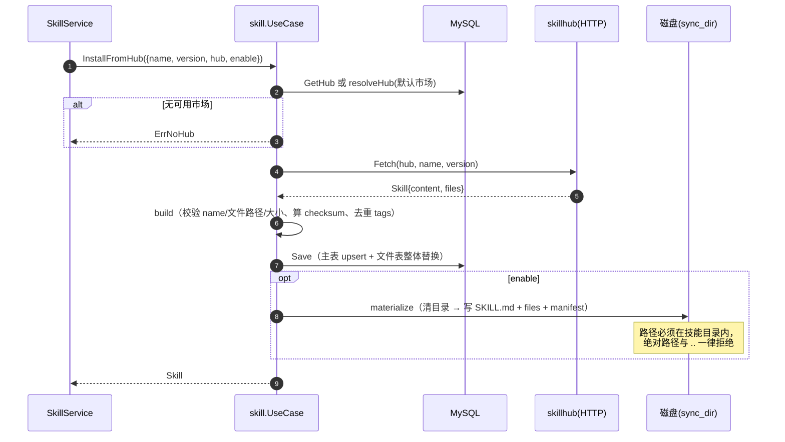

#### 改动指南 / 坑

- **`syncDir` 为空 = 只存库**（不落盘）。生产是否启用看 `data.skill.syncDir`。
- **`Save` 是「主表按 name 覆盖 + 文件表整体替换」**，不是增量；改文件要传全量。
- **路径安全**：`validFilePath` 拒绝绝对路径与 `..`；`materialize` 里还有一次 `HasPrefix(target)` 校验。
  新增文件写入逻辑时必须复用这两处，别自己拼路径。
- **名字规则**：`validName` 小写字母或数字开头，可含 `. _ -`，≤64；改名等于新建 + 删除。
- **升级语义**：同名安装会覆盖 content/files/checksum，`Enabled` 取决于入参（`nil` 时保持原状态）。
- **测试**：`skill_test.go`（安装/升级/启停/落盘/路径校验/市场）。

---

### 2.10 history（统一操作历史）

**定位**：回答「这次任务/这轮对话，到底用了什么」。五类记录统一落 `op_histories`，
供任务链路、会话链路时间线、管理端统计查询。

| kind | 中文 | 写入方 |
| --- | --- | --- |
| `mcp_call` | MCP 调用 | `mcp.CallTool` |
| `skill_use` | 技能使用 | `skill.UseSkill` |
| `memory_recall` | 记忆召回 | `memory.Recall` |
| `rag_recall` | RAG 召回 | `rag.Retrieve` |
| `graph_recall` | GraphRAG 召回 | `rag.GraphQuery` |

#### 时序图：记录是怎么带上 task/conv 的

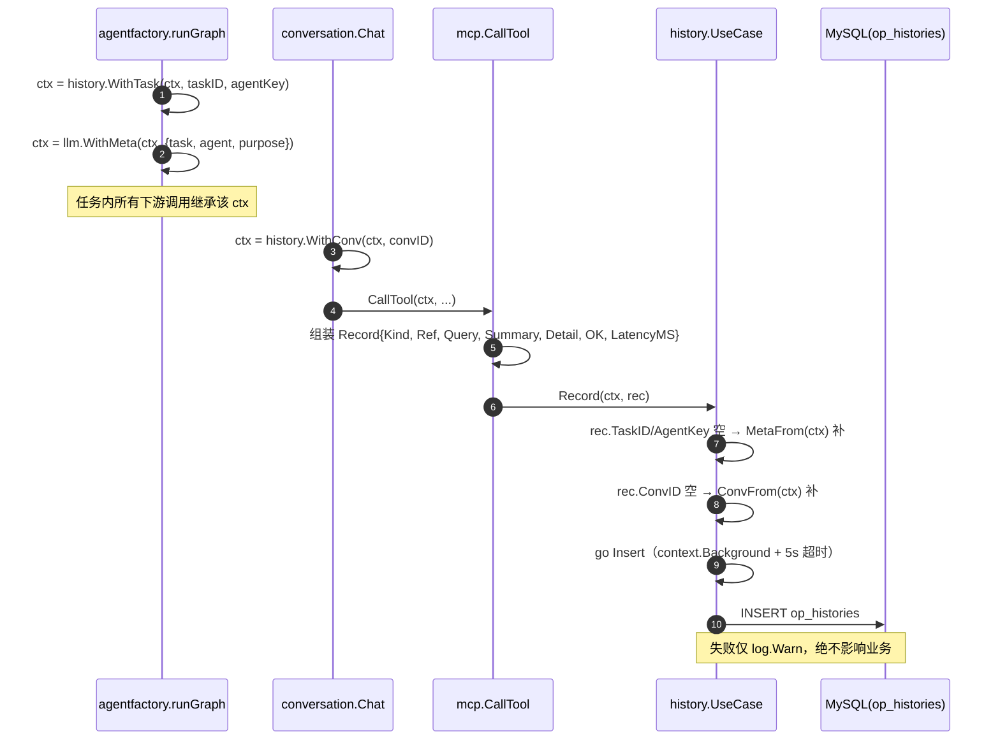

#### 坑（重要）

- **`WithTask` 会覆盖整个 ctxMeta**，把之前 `WithConv` 塞的 convID 丢掉；更要紧的是任务跑在 worker 的
  `workerCtx` 上，本身就没有 conv。所以「Agent 任务内」的 MCP 调用 `conv_id` 为空，
  会话链路时间线看不到它们（分析与修复见 5.2）。
- **`Detail` 是字符串 JSON**：各模块自己序列化（`memory.RecallDetail`、`rag.buildRecallDetail`、
  `rag.buildGraphDetail`）。前端按 `kind` 分别解析，改结构要同步前端。
- **`Query` 是摘要不是原文**：MCP 是 args JSON，memory 是 `query@userID`，rag 是问题原文。
- **`ValidateKind`**：查询时非法 kind 返回 `ErrInvalidKind`，不是空列表。

---

### 2.11 embedder（向量化客户端）

**定位**：最小的能力包。封装 OpenAI 兼容的 `POST {base}/embeddings`，供 rag / memory / mcp / agentfactory 共用。

**文件**：`embedder.go`（119 行）。

要点：

- 配置来自 `data.embedding`：`baseURL` / `apiKey` / `model` / `dimension` / `httpTimeout`。
- `Embed` 批量、**返回顺序与输入一致**（按 `index` 回填，缺一个就报错）。
- **维度强校验**：返回维度 ≠ 配置 `dim` 直接报错（提示检查 `EMBED_DIM`）。
- 401/403 且未配 `apiKey` 时给出可读提示（「若与 LLM 同一服务商，可直接复用 `LLM_API_KEY`」）。
- `EmbedOne` 是单条封装；`Dim()` / `Model()` 用于建集合与展示。

**坑**：改 `dimension` 必须重建 Milvus 集合（维度写死在 schema 里），否则插入直接失败。
换 embedding 模型 = 全量重新向量化，否则新旧向量不可比。

---

### 2.12 agent（空目录）

`internal/biz/agent/` 下**没有任何 Go 文件**，是历史残留（早期 Agent 相关的实验代码已并入 `agentfactory`）。
它不会被编译、不影响构建。**建议清理**（`rmdir`），但清理前确认没有脚本/文档引用这个路径。

### 2.13 aiplatform（外部 AI 平台：千问 / 阿里云百炼）

**定位**：把「平台」当**数据源**登记（千问 / 百炼 / 自建 MCP 广场），从平台目录搜索 MCP 服务并接成本地
MCP 服务；顺带兼容平台的技能分发（登记技能市场 / 按 URL 装包）。

**核心原则：接入动作一行都不重复实现**。创建服务、连接、拉 `tools/list`、向量化、能力目录刷新、
Redis 失效全部复用 `mcp.UseCase`，本模块只做「平台语义 → `mcp.ServerInput`」的映射。

**文件**：

| 文件 | 内容 |
| --- | --- |
| `internal/biz/aiplatform/types.go` | 常量（kind / auth / transport / 千问路径模板）、错误、`Platform` `RemoteMCP` `Input` `ImportInput`、`Normalize` `ResolveEndpoint` `AuthHeaders` `LocalServerName` `Masked` |
| `internal/biz/aiplatform/ports.go` | `Repo` / `Catalog` / `MCPRegistry` / `SkillMarkets` |
| `internal/biz/aiplatform/aiplatform.go` | `UseCase`：List/Get/Create/Update/Delete/SetDefault + SearchMCP / ImportMCP / Test |
| `internal/data/db/models/ai_platform.go` | `ai_platforms` 表（`api_key` 列 `json:"-"`） |
| `internal/data/db/repo/aiplatform.go` | `AIPlatformRepo`（启动 AutoMigrate） |
| `internal/data/third_service/aiplatform/client.go` | 目录 HTTP 客户端（容错解码，见坑 1） |

**千问形态（唯一需要记住的常量）**：

```text
base_url         https://dashscope.aliyuncs.com
catalog_path     /api/v1/mcps
streamable_path  /api/v1/mcps/{code}/mcp
sse_path         /api/v1/mcps/{code}/sse
鉴权             Authorization: Bearer $DASHSCOPE_API_KEY
```

`kind=qwen`（或 `bailian`）时 `Normalize` 自动补齐上述四项，用户只需给 `name` + `api_key`。

**端口与实现**：

| 端口 | 实现 | 说明 |
| --- | --- | --- |
| `Repo` | `repo.AIPlatformRepo`（data 侧构造） | `name` 唯一；`SetDefault` 走事务先清其它再置位 |
| `Catalog` | `aiplatform.Client`（data 侧构造，`wire.Bind` 在 `data.ProviderSet`） | 只有一个方法 `Search(ctx, p, keyword, limit)` |
| `MCPRegistry` | `*mcp.UseCase`（**绑定在 `cmd/go_agent/wire.go`**） | `ListServers` / `CreateServer` / `DeleteServer` / `ConnectServer` / `SyncTools` |
| `SkillMarkets` | `*skill.UseCase`（同上） | 保存平台时 upsert `<name>-skills` 技能市场 |

**时序：ImportMCP（接入一个平台服务）**

```text
ImportMCP(platform, code, transport, namespace)
  ├─ resolvePlatform        # 空 = 默认平台 → 第一个启用平台 → ErrNoPlatform
  ├─ ResolveEndpoint(code)  # transport=sse 但本地只支持 http → 降级 /mcp 并写 message
  ├─ findServer(本地名)      # <platform>-<code> 全小写
  │    └─ 已存在：ConnectServer + SyncTools，Reused=true（不覆盖用户改过的配置）
  ├─ 不存在：CreateServer(name, http, endpoint, headers=AuthHeaders(), namespace)
  ├─ ConnectServer 失败 → DeleteServer 回滚 → ErrImportFailed（502）
  └─ SyncTools             # 拉 tools/list → 向量化 + 能力目录 + Redis 失效，走 biz/mcp 原链路
```

**时序：Test（连通性测试）**

先打目录接口；目录失败但**路径模板能解析出 URL** 时仍返回 `ok=true`，message 提示「目录不可用，
可用按编码接入」。这条是为了让目录接口不存在时用户仍能判断「地址模板 + Key 是对的」。

**坑**：

1. **平台目录列表 API 不是公开契约**。千问 / 百炼公开文档只给「MCP 服务地址
   `/api/v1/mcps/{code}/mcp`」，没有稳定的列表接口，实测可能 404 或返回 HTML。
   所以客户端把 404 / 405 / HTML 统一映射成 `ErrCatalogUnsupported`（422/400 提示改用「按编码接入」），
   而不是让整个功能不可用；`catalog_path` 可配，解码器对 `mcps|servers|items|list|data|result`
   等外层键做 ≤3 层下钻，字段名同时认 camelCase 与 snake_case。
2. **SSE 不可用**：本地 MCP 客户端只实现 Streamable HTTP（POST JSON-RPC），`transport=sse`
   一律降级到 `/mcp`，并把降级写进 `ImportResult.message`——不能静默改，否则前端以为走的是 SSE。
3. **Update 不能重置 `base_url`**：`Normalize` 会给 qwen 补默认值，所以 Update 前先
   `inheritInput(cur, &in)` 用当前值预填未传字段，再 Normalize。否则改个描述会把自建地址冲掉
   （`TestUpdateKeepsCustomBaseURL` 守着）。
4. **`api_key` 只进不出**：proto 只回 `has_key`；Update 时 `api_key` 留空 = 不改。否则前端回显脱敏值
   会把真 key 覆盖成 `sk-***`。
5. **默认平台唯一**：`SetDefault` 事务内先清所有 `is_default` 再置 1；`Save` 时若 `IsDefault` 也走同一路径。
6. **技能市场登记失败不阻断**：`Create/Update` 保存成功后调 `syncSkillHub`（upsert，token 用平台
   API Key），失败只回 `PlatformReply.warning`，平台照样可用。
7. **`kind` 省略要能推断**：`Normalize` 里 `kind` 为空时走 `inferKind(name)`（含 qwen / bailian
   走对应预设，否则 generic）。否则「`name=qwen` + `api_key` 即可」这条文档捷径会在服务端报
   `base_url 不能为空`（`TestNormalizeInfersKindFromName` 守着）。
8. **平台 401 不能落成 500**：目录客户端 401/403 包裹 `ErrAuthFailed`，`mapAIPlatformErr` 映射成
   502 + 可读文案（Key 无效 / 无 MCP 广场权限）。实测直接打 dashscope 会返回
   `InvalidApiKey`，接入时会走到「连接失败 → 回滚删服务 → `ErrImportFailed`」这条路径。

**测试**：`aiplatform_test.go`（13 个用例，手写 `fakeRepo` / `fakeCatalog` / `fakeMCP` / `fakeHubs`）、
`third_service/aiplatform/client_test.go`（httptest 覆盖 `data.mcps` 包裹、裸数组、404、HTML、401、模板查询）。
必须跑的三个：`TestImportMCPRollsBackWhenConnectFails`、`TestImportMCPSSEFallsBackToHTTP`、
`TestUpdateKeepsCustomBaseURL`。

**前端**：`frontend/src/pages/AIPlatforms.jsx` 两个 Tab——「平台」（CRUD / 测试 / 设默认 / 千问预设）
与「MCP 广场」（目录搜索 + 接入 + 按编码接入）。

---

## 3. 跨模块协作

### 3.1 一次会话请求写了哪些地方

以「用户在会话里问一句，LLM 决定调一个 MCP 工具」为例，数据落点如下——**排查「为什么这里没数据」时按这张表逐项对**：

| 落点 | 表/键 | 写入方 | 触发条件 |
| --- | --- | --- | --- |
| 用户消息 | `conversation_messages` | `conversation.Append` | 总是 |
| 助手消息 + 链路 meta | `conversation_messages.meta` | `conversation.Chat` | 总是（失败也写，`meta.ok=false`） |
| 记忆召回 | `op_histories`(kind=memory_recall) | `memory.Recall` | `deps.Memory != nil` 且召回被调用 |
| RAG 召回 | `op_histories`(kind=rag_recall) | `rag.Retrieve` | `deps.Rag != nil` 且命中/出错 |
| 图谱召回 | `op_histories`(kind=graph_recall) | `rag.GraphQuery` | 仅 `GraphQuery`；`GraphRecall` **不写** |
| MCP 调用 | `op_histories`(kind=mcp_call) | `mcp.CallTool` | 每次工具调用 |
| LLM 调用 | `llm_calls` | `llm.Manager.record` | 每次模型调用（含失败） |
| 任务（Agent 委派） | `agent_tasks` / `agent_task_history` + `agent_task_events` | `agentfactory` | action=agent |
| 任务内工具/召回 | `op_histories`（带 task_id，**conv_id 可能为空**） | 各能力 | 见 5.2 |

### 3.2 上下文传播（两套独立机制，别混）

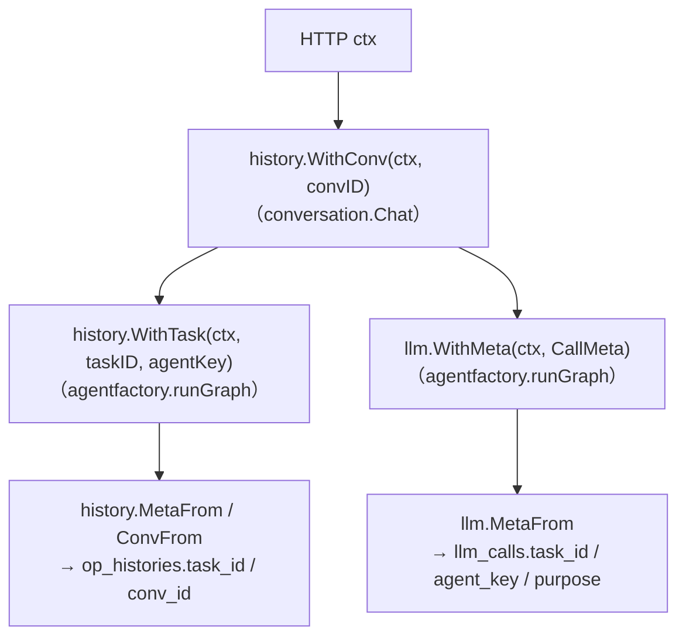

- `history.ctxMetaKey` 与 `llm.ctxMetaKey` 是**不同的 key**，互不干扰。
- `WithTask` 是「整体覆盖」写法，会丢掉 convID（已知缺陷，见 5.2）；`WithConv` 是「读改写」，会保留 taskID。
- 想给某个下游调用补身份，用 `WithXxx` 包一层 ctx 往下传，**不要**改方法签名加参数。

### 3.3 链路查询的数据拼装（前端「链路」弹层依赖）

会话链路一条时间线 = 三种数据按时间合并：

1. `conversation_messages`：用户/助手/辩论发言（`meta.op` 区分 `chat` / `debate` / `debate_summary`）。
2. `op_histories`：按 `conv_id` 查（`GET /api/histories?conv_id=`），五类召回与调用。
3. `llm_calls`：按 `task_id`（或全局看 `purpose`），用于「这轮为什么慢/花多少 token」。

任务链路 = `agent_task_events`（trace）+ 该 `task_id` 的 `op_histories` + 该 `task_id` 的 `llm_calls`。

**约定**：`meta` 里的 `*_list` 字段（`memories_list`/`rag_hits_list`/`graph_entities_list`/
`graph_relations_list`/`mem_graph_*_list`）是给前端做「默认展开明细」用的，最多 20 条、
文本截 160~240 字。改字段名 = 破坏前端契约，必须同步 `frontend/src/components/ConvTraceDrawer.jsx`。

### 3.4 失败降级矩阵（哪些能忍、哪些必须报错）

| 能力 | 失败影响 | 处理方式 |
| --- | --- | --- |
| 记忆召回 | 少一段上下文 | best-effort，写 `meta.mem_error` |
| RAG 召回 | 少一段上下文 | best-effort，写 `meta.rag_error` |
| 图谱召回 | 少一段上下文 | best-effort，写 `meta.graph_error` |
| 记忆写入的图谱抽取 | 记忆已入库，图谱缺节点 | 返回 `GraphWarning`，不失败 |
| MCP 工具向量化 | 工具可见但搜不到 | `SyncResult.Warning` |
| LLM 调用历史写入 | 无记录 | 异步 + 告警 |
| 操作历史写入 | 无记录 | 异步 + 告警 |
| 对话 LLM 调用 | 本轮无有效回复 | 落 `meta.ok=false` 的助手消息，不返回 error |
| 文档分块入库 | 文档不可用 | 整体失败 + `status=failed` 落库 |
| 记忆向量化 | 记忆不可召回 | **整体失败**（先向量后 MySQL，保持一致） |
| Milvus 集合初始化 | 服务起不来 | 启动期 `EnsureCollection` 直接返回错误 |

---

## 4. 新增一个 biz 模块的 checklist

按顺序做，每步都可独立验证：

1. **建包**：`internal/biz/<name>/`，四个文件起步：`types.go`（领域模型+错误+常量）、`ports.go`（接口）、
   `<name>.go`（用例）、`<name>_test.go`（fake repo）。
2. **写端口**：所有外部依赖都定义为接口，**不要 import `internal/data`**。
   需要别的 biz 能力时，也定义最小接口（如 `harness.Chatter`），不要直接依赖 `*llm.Manager`。
3. **写用例**：构造函数 `New(...) (*UseCase, error)`；参数校验集中在 `normalizeXxx`；哨兵错误。
4. **proto**：`api/<name>/v1/*.proto`，HTTP 路径统一 `/api/<name>/**`；
   新增字段遵守「零值 = 旧行为」，然后 `buf generate` → `python3 patch_openapi.py`（如仓库有此步）→ `gen-sdk`。
5. **wire 绑定**：
   - biz 侧 `biz.go`：`<name>.New` + 需要的 `wire.Bind`；
   - data 侧 `data.go`：`dbrepo.New<Name>Repo` + `wire.Bind(new(<name>.Repo), ...)`；
   - 跑 `go generate ./...`（或 `wire`）重新生成 `wire_gen.go`，**不要手改 wire_gen**。
6. **service**：`internal/service/<name>_service.go`，只做「proto ↔ 领域」翻译 + `errors.Is` 映射。
7. **注册**：`internal/service/service.go` 的 ProviderSet / `RegisterHTTP`。
8. **测试**：`go build ./...` + `go test ./internal/biz/<name>/...` + `go vet ./...`。
9. **文档**：在本文件加一节（模板同上）；改动跨模块契约时更新第 3 章。

**反例（不要这样做）**：在 biz 里 `import "gorm.io/gorm"`；在 service 里写业务判断；
把 `*redis.Client` 塞进 UseCase；为了图省事让 `harness` 直接调 `agentfactory` 内部函数。

---

## 5. 已知问题与待办（交接必读）

按「影响面 × 紧急度」排序，每条都给了建议改法。

### 5.1 harness 未接线（P0，功能不可用）

**现象**：`harness` 包可编译、单测通过，但没有任何 HTTP 接口，管理端看不到评测功能。

**缺什么**：

1. `api/harness/v1/harness.proto` + `buf generate`；
2. `internal/data/db/models/harness.go` + `repo/harness.go`（四张表：`harness_sets` / `harness_cases` /
   `harness_runs` / `harness_run_items`）；
3. `Runner` 适配器（`agent:` → `agentfactory`，`model:` → `llm.Manager.ChatWith`）；
4. `biz.go` / `data.go` 的 ProviderSet + Bind；
5. `internal/service/harness_service.go` + 注册。

**建议**：`Runner` 适配器放 `internal/data/agentrunner/`，避免 biz 之间硬依赖。
设计细节见 `biz/harness/设计方案.md`。

### 5.2 `WithTask` 覆盖 `conv_id`（P1，链路缺数据）——已修复（2026-10-31）

> **修复内容**（三处 + 单测，全部落地）：
> 1. `history.WithTask` 改为读改写：保留 ctx 里已有的 convID，与 `WithConv` 可任意叠加
>    （`internal/biz/history/history.go`，单测 `history_test.go` 4 例）。
> 2. `runGraph` 开头 `WithTask` 之后用 `rec.task.ConvID` 回填 `WithConv`
>    （`internal/biz/agentfactory/runtime.go`）：worker ctx 从头没有 conv，任务内 MCP / 记忆 / RAG
>    落 `op_histories` 时取 `ConvFrom(ctx)` 得以带上来源会话。
> 3. `runChildTask` / `createChildTask` 建子任务时继承 `parent.ConvID`
>    （`runtime.go` / `workflow.go`）：任务树所有层级可按会话过滤
>    （单测 `TestConvIDInheritance`）。
>
> 以下为原始分析存档。

**现象**：Agent 任务内部产生的 `op_histories` 记录 `conv_id` 为空，会话链路时间线看不到这些调用。

**根因**（两层）：

1. **主因**：任务在 worker 里执行，ctx 派生自 `workerCtx`（进程级），**从头就没有 conv**。
   会话调用 `SubmitTask` 时只把会话写进了 `Task.ConvID`（数据库字段），没有进 ctx。
2. **放大因素**：`history.WithTask` 用 `context.WithValue(ctx, key, ctxMeta{taskID, agentKey})` **整体覆盖**，
   即使上游 ctx 里有 conv 也会被抹掉。

**建议改法**（B 是必须的，A 是防御性加固）：

```go
// B（必须）. runtime.go runGraph 开头，从任务行回填会话身份
ctx = history.WithTask(ctx, rec.task.ID, def.AgentKey)
if rec.task.ConvID != "" {
    ctx = history.WithConv(ctx, rec.task.ConvID)   // 必须在 WithTask 之后
}

// A（建议）. WithTask 改成读改写，避免以后再踩同一个坑
func WithTask(ctx context.Context, taskID uint64, agentKey string) context.Context {
    m := ctxMeta{taskID: taskID, agentKey: agentKey}
    if old, ok := ctx.Value(ctxMetaKey{}).(ctxMeta); ok {
        m.convID = old.convID
    }
    return context.WithValue(ctx, ctxMetaKey{}, m)
}
```

> 注意顺序：`WithConv` 是「读改写」，`WithTask` 是「覆盖」。要么先 `WithTask` 再 `WithConv`（B），
> 要么把 `WithTask` 改成 A 的写法。两者都做最稳。

改完补单测：构造带 `ConvID` 的 Task 走 `runGraph`，断言产生的 `op_histories.conv_id` 非空。

### 5.3 `biz/agent` 空目录（P3）

无 Go 文件，属历史残留。确认无引用后删除。

### 5.4 两套「辩论」实现（P2，容易改错地方）

| | `conversation.debate` | `agentfactory.GraphDebate` |
| --- | --- | --- |
| 目的 | 产品功能：用户在会话里看多角色辩论 | 执行图：任务内用辩论提升答案质量 |
| 过程可见性 | 每条发言落 `conversation_messages`，前端实时看 | 只有 `task_events`，最终只返回汇总答案 |
| 控制 | 暂停/恢复/叫停/增减角色 | 无外部控制 |
| 入口 | `/api/conversations/{id}/debates/**` | `AgentDef.GraphType = "debate"` |

改「辩论」需求前先确认是哪一套，**不要**在 `graphs.go` 里找暂停按钮。

### 5.5 其他待办

| # | 事项 | 影响 | 建议 |
| --- | --- | --- | --- |
| 1 | `mcp` / `embedder` 无单测 | 改动回归靠手测 | `history` 与 `platformmcp` 已补齐（`history_test.go` / `platformmcp_test.go` / `server/mcp_test.go`）；`mcp.SearchTools` 的降级路径仍建议补 fake 测试 |
| 2 | `rag.Ingest` 先写向量后写 MySQL | 极端情况留下孤儿向量 | 已用「查不到 MySQL 就跳过」兜底；可加定期对账任务 |
| 3 | `def.LLMModel` 只是提示词前缀（`def.LLMSource` 已是真选源，见 2.x 坑 5） | 无法真正按模型选源 | 在 `llm.Manager.candidates` 加 `model` 维度过滤 |
| 4 | 会话里 Agent 委派是同步轮询（最长 5 分钟） | 长任务会拖住 HTTP | 前端超时对齐，或改成「先返回 task_id + 前端轮询」 |
| 5 | `GraphRecall` 不写 `graph_recall` 历史 | 会话里的图谱召回在 `op_histories` 看不到 | 若要统一，在 `rag.GraphRecall` 加 defer 记录（注意别和 `GraphQuery` 重复） |
| 6 | 长耗时接口仍吃全局 300s 超时 | 入库 / 图谱抽取失败时只能等超时，无法查进度 | 改「提交异步任务 + task_id 查进度」，HTTP 超时即可回落秒级 |
| 7 | 停机期间 `SubmitTask` 返 `ErrShuttingDown`，但 `mapAgentFactoryErr` 没这条分支 | 客户端看到 500 而不是 503，重试策略会误判 | 在 `internal/service/errors.go` 加 `errors.Is(err, agentfactory.ErrShuttingDown)` → `503` + `Retry-After` |
| 8 | 千问/百炼的「MCP 目录列表」不是公开契约（见 2.13 坑 1） | 目录搜索可能直接不可用，只能按 mcpCode 接入 | 已有兜底（`ErrCatalogUnsupported` + 按编码接入 + `Test` 模板探测）；拿到官方列表接口后只需改 `catalog_path` 与解码分支 |
| 9 | 千问技能只有下载链接、无统一安装 API | 技能侧靠「登记技能市场」或 `POST /api/skills/import-url` 兜 | 若拿到官方技能分发契约，在 `biz/skill` 加一个 `HubClient` 实现即可，不用改页面 |
| 10 | PDF 文本层解析依赖本机 `python + pdfplumber`（`internal/pkg/loader/pdf.go`） | 未安装时自动退回纯 Go，但中文财报类 PDF 会出现行序倒置 / ◆ 占位符（实测宝钢 2024 半年报乱码率 5.9%） | 装 `python -m pip install pdfplumber` 即可恢复；`RAG_PDF_DISABLE_PYTHON=1` 可显式关闭外部引擎排查问题 |

### 5.6 GORM map 更新列名写错（已修复，2026-11-01）

**现象**：更新 Agent 编排保存时报 `Error 1054 (42S22): Unknown column 'flow' in 'field list'`。

**根因**：`internal/data/db/repo/agentfactory.go` 的 `Updates(map[string]any{...})` 里 key 写成了 `"flow"`，
而表列名是 `flow_json`。**GORM 的 map 更新不走 struct tag 映射，key 直接当列名**，所以编译期完全发现不了。

**修复**：key 改为 `flow_json`，并新增 `internal/data/db/repo/columns_test.go`
（`TestMapUpdateKeysMatchModelColumns`）：扫描 repo 层所有 `Updates(map[string]any{...})` 的字面量 key，
与所有模型 `gorm:"column:..."` + GORM 默认列名比对，写错就单测失败。

> 顺带确认：`flow` 允许为空（`flow_json` 为 `NULL` 或 `""`），空编排不回写、不报错。

### 5.7 平台只读 MCP 端点（已落地，2026-11-01）

`/mcp/platform` 把「任务中心 / 会话 / 链路 / 操作历史」暴露成 7 个只读 MCP 工具，让平台内的 Agent
可以直接查自己的执行链路，不用再写 SQL。要点：

- 实现在 `internal/biz/platformmcp`（工具定义 + 参数校验 + 调用），`internal/server/mcp.go` 只做协议皮
  （`mark3labs/mcp-go` + Streamable HTTP 无状态），`internal/service/platform_mcp_service.go` 负责推导
  endpoint、幂等自注册为 MCP 服务并同步工具（`AfterStart` 后台重试 10 次）。
- **只读**：没有任何写工具；参数统一对象化，payload 递归截断，避免把整条链路塞爆上下文。
- **仅本机**：`isLoopback` 守卫，非回环一律 403。
- 工具级错误走 `result.isError`（MCP 规范），不是 JSON-RPC error；未知工具由库回 `-32602`。
- 详见 `internal/server/MCP网关方案.md`。**注意**：那份方案里的「对外工具聚合网关（`/mcp` + api_key）」
  尚未实施，属二期。

---

## 6. 运维与排障速查

### 6.1 启动顺序与硬依赖

```text
conf.Load（支持 ${ENV:default}）
  → wireApp：MySQL(GORM AutoMigrate) → Redis → Milvus(gRPC)
  → prompt.New（seed 内置模板）
  → rag.NewRag（EnsureReady）
  → memory.New（EnsureCollection，120s 超时）
  → mcp.New（不连外网，懒连接）
  → agentfactory.New
  → conversation.NewUseCase（收尾孤儿辩论）
  → app.Run：
      BeforeStart → agentfactory.StartWorkers()（恢复中断任务 + worker 池 + cron）
      AfterStart  → platformMCP.EnsureServer()（后台重试 10 次，自注册 /mcp/platform 并同步工具）
      BeforeStop  → agentfactory.Drain(ctx)（停止领新任务，等执行中任务跑完，上限 shutdownTimeout）
      AfterStop   → agentfactory.Stop() / mcp.Manager().CloseAll()
```

停机细节见 2.2「优雅停机（draining）」；`shutdownTimeout` 默认 20s，要小于编排层 kill 期限。

**MySQL / Redis / Milvus 任一不可用 → 启动直接失败**（刻意快速失败）。
`main.fatal` 会打印「排查：docker compose ps 确认 mysql/redis/milvus 已 healthy」。

### 6.2 现象 → 原因 → 处理

| 现象 | 最可能原因 | 处理 |
| --- | --- | --- |
| 启动失败，日志停在 milvus | Milvus 未就绪 / 集合维度不匹配 | `docker compose ps`；确认 `EMBED_DIM` 与集合维度一致（不一致要重建集合） |
| 启动成功但 `/api/health` 之外全 500 | 依赖集合残缺（有集合无索引） | 看日志「缺索引且补建失败」；`EnsureCollection` 会自愈，等索引建完 |
| 会话开不了新辩论 | 存在 `running/paused/stopping` 的孤儿辩论 | 重启（自动收尾）或手动 `UPDATE debates SET status='stopped'` |
| 任务一直 pending | Redis 队列没消费 / worker 没启动 | 看启动日志有无「恢复中断任务」；确认 `data.agentfactory.workerCount > 0`；查 `af:task:*` 快照 |
| 任务 running 但没进度 | 卡在 LLM 调用 / 工具调用超时 | 查 `llm_calls` 最近记录与耗时；查 `agent_task_events` 最后一条 |
| 任务重复执行 | 多副本 + Redlock 失效 | 查 Redis `af:lock:task:<id>`；确认 Redlock Quorum 配置 |
| 工具列表有、搜不到 | 向量化失败（`Vectorized=false`） | 重新同步该 server；看 `SyncResult.Warning` |
| 改了提示词不生效 | 缓存未失效 | 检查写操作是否调 `invalidate`；必要时删 `prompt:ver:<key>` |
| 文档重复入库/入库卡住 | `rag:lock:ingest:<docID>` 残留（进程被杀） | 锁有 10 分钟 TTL，等待或手动删 key |
| 记忆召回为空 | 向量残留但 MySQL 无记录 / 全部过期 | 查 `memories.expires_at`；跑 `POST /api/memory/long/purge` 后重新 `Remember` |
| 会话助手回复「本轮执行失败：…」 | LLM 或工具全挂 | 看该消息 `meta.error` + `llm_calls` 失败记录 |
| 链路弹层没有召回明细 | `meta.*_list` 为空（旧消息或版本早于该功能） | 新消息才有；老数据需重新对话 |
| 停机日志出现「优雅停机等待超时」 | 执行中任务超过了 `shutdownTimeout` | 正常兜底：任务保持 `running`，重启后 `RequeueInterrupted` 自动重跑；要减少中断就把 `shutdownTimeout` 调大（仍须 < k8s grace period） |
| 停机期间提交任务返回 500 | `ErrShuttingDown` 未做 HTTP 映射 | 已知问题（5.5 #7）；客户端按可重试处理，重启后再提交 |
| 保存 Agent 编排报 `Unknown column` | GORM map 更新的 key 与列名不一致 | 跑 `TestMapUpdateKeysMatchModelColumns` 定位；`flow_json` 不是 `flow` |
| `/mcp/platform` 返回 403 | 非本机来源（或走了容器外网卡 / 反向代理） | 端点只允许回环；Agent 与本机 MCP 管理器都走 `127.0.0.1` |

### 6.3 常用验证命令

```bash
# 编译 + 单测（biz 全量）
go build ./... && go test ./internal/biz/... 

# 只跑某模块
go test ./internal/biz/conversation/... -run TestChat -v

# 优雅停机三条路径（排空 / 拒新任务 / 超时保留 running）
go test ./internal/biz/agentfactory/ -run TestDrain -v -race

# conv_id 继承（父任务 → 子任务）
go test ./internal/biz/agentfactory/ -run TestConvIDInheritance -v

# 健康检查
curl -s localhost:8000/api/health

# 会话一轮（观察 meta 链路）
curl -s -X POST localhost:8000/api/conversations/c-xxx/chat \
  -H 'Content-Type: application/json' -d '{"content":"你好"}'

# 任务链路
curl -s "localhost:8000/api/agentfactory/tasks/1/events?limit=50"

# 操作历史（按会话）
curl -s "localhost:8000/api/histories?conv_id=c-xxx&limit=50"

# 辩论当前状态
curl -s localhost:8000/api/conversations/c-xxx/debates/current
```

### 6.4 日志关键字

| 关键字 | 含义 |
| --- | --- |
| `[conversation] 启动恢复：收尾 N 场孤儿辩论` | 上次进程异常退出，已自动收尾 |
| `恢复中断任务` | 崩溃恢复把 running 置回 pending 并重新入队 |
| `[llm] 数据源调用失败，尝试下一个` | 场景路由在故障切换 |
| `[llm] 调用历史写入失败` | 只影响可观测性，不影响业务 |
| `[history] 操作历史写入失败` | 同上 |
| `memory: 图谱抽取失败（记忆已入库）` | 记忆成功、图谱缺失，属降级 |
| `缺索引且补建失败` | Milvus 集合残缺且自愈失败，需人工介入 |
| `开始优雅停机：停止领取新任务` | 收到停机信号，`Drain` 开始（带 `in_flight` 与 `timeout`） |
| `优雅停机完成：执行中的任务已全部结束` | 正常排空，进程可安全退出 |
| `优雅停机等待超时，强制中断执行中的任务` | 超过 `shutdownTimeout`，任务保持 `running`，重启自动重跑 |
| `平台 MCP 服务已就绪` / `平台 MCP 服务注册/同步失败` | 自注册 `/mcp/platform` 的结果（失败会重试 10 次） |

---

## 附录 A：biz 端口 → 实现 → 存储 一览

| 模块 | 端口 | 实现 | 存储 |
| --- | --- | --- | --- |
| conversation | `Repo` | `dbrepo.ConversationRepo` | MySQL 3 表 |
| agentfactory | `Repo` / `VectorStore` / `Cache` / `TaskLock` / `Chatter` / `Embedder` / `ToolPort` | `dbrepo.AgentFactoryRepo` / `mvrepo.AgentStore` / `redis.AgentFactoryCache` / `redis.TaskLock` / `llm.Manager` / `embedder.EmbeddingClient` / `mcp.UseCase` | MySQL 4 表 + Milvus + Redis |
| harness | `Repo` / `Runner` / `Chatter` | **未实现** / **未实现** / `llm.Manager` | 待建 |
| memory | `LongTermRepo` / `ShortTermStore` / `VectorStore` / `GraphStore`(=graphrag.Store) | `dbrepo.MemoryRepo` / `redis.ShortTermStore` / `mvrepo.MemoryStore` / `mvrepo.GraphStore` | MySQL + Redis + Milvus |
| rag | `ChunkStore` / `DocumentRepo` / `AnswerCache` / `Locker` / `Embedder` / `Chatter` / `Prompter` | `mvrepo.ChunkStore` / `dbrepo.DocumentRepo` / `redis.AnswerCache` / `redis.AnswerCache` / `embedder` / `llm.Manager` / `prompt.UseCase` | MySQL + Milvus + Redis |
| graphrag | `Store` / `Embedder` / `Chatter` / `Prompter` / `Splitter` / `Evidence` | `mvrepo.GraphStore` / `embedder` / `llm.Manager` / `prompt.UseCase` / `rag.Chunker` / `rag.evidenceAdapter` | Milvus 2 集合 |
| prompt | `Repo` / `Cache` | `dbrepo.PromptRepo` / `redis.PromptCache` | MySQL 2 表 + Redis |
| mcp | `Repo` / `VectorStore` / `Cache` / `Dialer` / `ClientProvider` / `Embedder` | `dbrepo.MCPRepo` / `mvrepo.ToolStore` / `redis.MCPCache` / `mcpclient.Dialer` / `mcpclient.HTTPClientProvider` / `embedder` | MySQL 2 表 + Milvus + Redis |
| llm | `ProviderRepo` / `CallRepo` | `dbrepo.LLMProviderRepo` / `dbrepo.LLMCallRepo` | MySQL 2 表 |
| skill | `Repo` / `HubClient` | `dbrepo.SkillRepo` / `skillhub.Client` | MySQL 3 表 + 磁盘 |
| aiplatform | `Repo` / `Catalog` / `MCPRegistry` / `SkillMarkets` | `dbrepo.AIPlatformRepo` / `aiplatform.Client` / `*mcp.UseCase` / `*skill.UseCase` | MySQL `ai_platforms`（MCP/Skill 侧复用各自存储） |
| history | `Repo` | `dbrepo.HistoryRepo` | MySQL `op_histories` |
| embedder | 无端口（被依赖方） | `embedder.EmbeddingClient` | 无 |

## 附录 B：常量速查

| 位置 | 常量 | 值 |
| --- | --- | --- |
| `conversation/chat.go` | `chatMaxTurns` / `chatMaxHistory` / `chatObservationCl` | 6 / 20 / 3000 |
| `conversation/chat.go` | `chatRagTopK` / `chatMemTopK` / `chatToolLimit` | 5 / 5 / 50 |
| `conversation/chat.go` | `agentWaitTimeout` / `agentPollInterval` | 5min / 2s |
| `conversation/debate.go` | `debateMinRoles` / `debateMaxRoles` / `debateMaxRounds` | 2 / 6 / 12 |
| `conversation/debate.go` | `debateTranscript` / `debateClip` / 暂停轮询 | 40 / 600 / 1.2s |
| `agentfactory` | `Options.DefaultMaxTurns` / `WorkerCount` / `LockTTL` | 12 / 2 / 30s |
| `rag` | `topK` / `topN` / `embedBatch` / `cacheTTL` / 入库锁 | 10 / 5 / 配置 / 配置 / 10min |
| `graphrag` | `TopK` / `Hops` / `MaxEdges` / `MaxEntities` / `MaxRelations` | 8 / 2 / 200 / 10 / 8 |
| `memory` | `shortTTL` / `recallTopK` / `historyLimit` | 24h / 8 / 20 |
| `mcp` | `defaultTopK` / `maxTopK` / `defaultListLimit` | 8 / 50 / 200 |
| `llm` | 快照 TTL / HTTP 超时 | 30s / 120s |
| `harness` | `Concurrency` / `PerCaseTimeout` | 2 / 120s |
| `aiplatform` | `QwenBaseURL` / `QwenCatalogPath` / `QwenStreamablePath` / `QwenSSEPath` | `https://dashscope.aliyuncs.com` / `/api/v1/mcps` / `/api/v1/mcps/{code}/mcp` / `/api/v1/mcps/{code}/sse` |

## 附录 C：本目录文件索引

```text
internal/biz/
├── HANDOVER.md            ← 本文件
├── README.md              ← biz 模块索引（一页速查，细节指回本文件）
├── biz.go                 ← biz 侧 wire ProviderSet
├── agent/                 ← 空目录（见 5.3）
├── conversation/          ← 2.1
│   ├── conversation.go  chat.go  debate.go  types.go
│   └── conversation_test.go  chat_test.go
├── agentfactory/          ← 2.2
│   ├── agentfactory.go  runtime.go  graphs.go  graph.go  flow.go  workflow.go
│   ├── capability.go  factory.go  cron.go  schedule.go  roles.go  types.go  ports.go
│   ├── DESIGN.md          ← 设计讨论稿（非最终实现说明）
│   └── *_test.go（5 个：agentfactory / cron / graph / graphs / workflow）
├── harness/               ← 2.3（未接线）
│   ├── harness.go  judge.go  types.go  ports.go  doc.go  设计方案.md
│   └── harness_test.go
├── memory/                ← 2.4
│   ├── memory.go  detail.go  types.go  ports.go  memory_test.go
├── rag/                   ← 2.5
│   ├── rag.go  chunker.go  detail.go  ports.go  DESIGN.md
│   ├── graphrag/{service.go, extractor.go, types.go, DESIGN.md}
│   └── rag_test.go  chunker_test.go
├── prompt/                ← 2.6
│   ├── prompt.go  template.go  builtin.go  types.go  ports.go
│   └── prompt_test.go  template_test.go
├── mcp/                   ← 2.7
│   └── mcp.go  manager.go  types.go  ports.go
├── platformmcp/           ← 5.7（平台只读 MCP 工具）
│   └── platformmcp.go  platformmcp_test.go
├── llm/                   ← 2.8
│   ├── llm.go  manager.go  types.go  ports.go
│   └── manager_test.go  llm_test.go
├── skill/                 ← 2.9
│   └── skill.go  types.go  ports.go  skill_test.go
├── aiplatform/            ← 2.13（千问 / 百炼 MCP 广场）
│   └── aiplatform.go  types.go  ports.go  aiplatform_test.go
├── history/               ← 2.10
│   └── history.go  types.go  ports.go  history_test.go
└── embedder/              ← 2.11
    └── embedder.go
```

---

## 交接签收清单

- [ ] 能画出 1.4 的三条链路（会话 / 任务 / 检索）
- [ ] 能说清 `WithTask` / `WithConv` / `llm.WithMeta` 三个 ctx 注入的用途与差异（都是读改写，可叠加）
- [ ] 能说清优雅停机三步（`Drain` → 排空 / 超时 `Stop`）、超时任务为何保持 `running`
- [ ] 跑通 `go build ./... && go test ./internal/biz/...`（全绿）
- [ ] 手工验证：会话一轮（看 meta）、任务一次（看 events）、RAG 一次入库+问答、辩论一次暂停/恢复
- [ ] 知道 `/mcp/platform` 是只读 + 仅本机，加工具要改 `biz/platformmcp` 而不是 `server/mcp.go`
- [ ] 知道 harness 未接线、`biz/agent` 空目录、两套辩论实现
- [ ] 知道接入平台 MCP 服务只走 `biz/aiplatform`（复用 `mcp.UseCase`，不另写连接逻辑），且千问目录接口非公开契约
- [ ] 知道改配置后必须 `Invalidate()`（llm）与 `invalidate`（prompt）


## 2.15 Token 治理与提示词评测闭环（2026-11-02）

### LLM 调用通道
- `llm.CallOptions{JSONMode, MaxTokens}` + `Manager.ChatOpts(ChatOptions)`：
  JSON 模式走 `response_format=json_object`，数据源不支持（400 且报文含 response_format）自动降级重试一次。
- 各 `Chatter` 端口（agentfactory / harness / prompt.LLM）都加了 `ChatOpts` 方法；测试桩同步补齐。

### 工具循环（agentfactory/runtime.go runToolLoop）
- 滚动摘要：只保留最近 `keepRecentTurns=3` 轮全文，更早轮次由 `summarizeSection` 规则压缩成一行
  （不调 LLM，避免反向烧 token）。
- 去重：`seen[能力|argsJSON]` 相同调用直接复用并提示模型勿重复调用。
- 预算熔断：累计发送字符超 `transcriptBudget=120_000` 强制收敛轮。
- 观察用 `<observation tool=... turn=...>` 结构化包裹。
- `buildSystemPrompt` 改为「输出协议（全 Agent 相同）在前」——利于前缀缓存命中。

### RAG 精排（rag/rerank.go）
- `conf.Data.rerank{enabled,provider(cohere|dashscope),baseURL,apiKey,model,topN}`；
  Retrieve 后对 topK 精排，失败静默降级原序。

### 提示词评测闭环
- harness `RunConfig.PromptKey/PromptVersion`（proto StartRunRequest 字段 6/7）→ 终态异步回写
  `prompt_version_scores`（新表，AutoMigrate）；`harness.ScoreRecorder` 绑定 `*prompt.UseCase`
  **在 cmd/go_agent/wire.go**（跨层绑定老规矩）。
- 查询：`GET /api/prompts/{key}/scores`；前端 Prompts 版本历史展示得分 + 「评测」深链
  `#/eval?prompt=&version=`（Eval 预填 target=agent:<key>）。

### Token 下钻
- `GET /api/llm/calls/breakdown?dim=agent_key|scene|purpose|model&days=N`；
  维度白名单防注入；前端 LLM 页「Token 用量下钻」面板。
