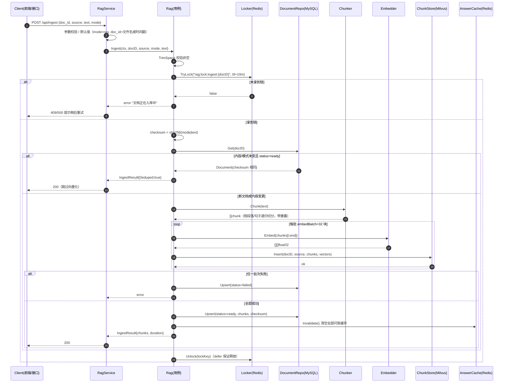
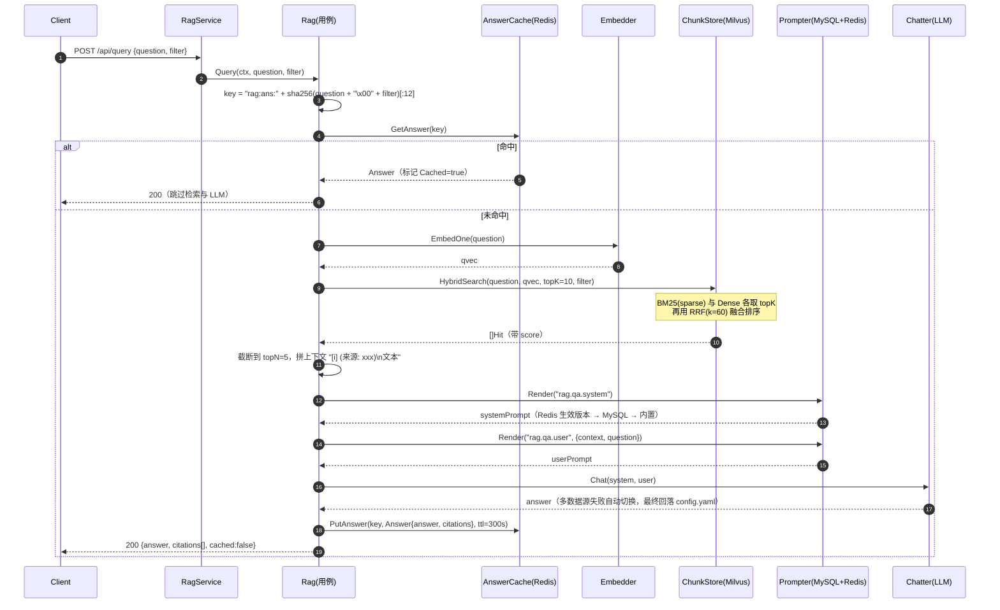
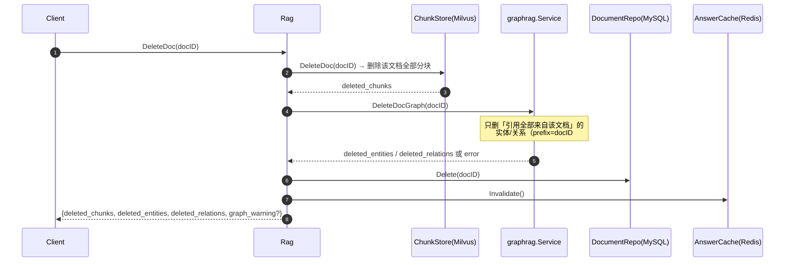

# RAG 业务设计说明

> 代码位置：`internal/biz/rag`　入口：`internal/service/rag_service.go`（`/api/*`）
> 相关文档：[GraphRAG 设计说明](./graphrag/DESIGN.md)

## 1. 定位与职责

`rag` 包是 RAG 的**用例层**（Kratos DDD 的 biz）：编排「分块 → 向量化 → 入库 → 检索 → 生成 → 缓存」全链路，
本身**不 import 任何具体实现**，只依赖 `ports.go` 中的接口。具体存储、模型调用分别在 `internal/data` 与 `biz/embedder|llm|prompt` 中实现，由 wire 注入。

两条并行业务线：

| 业务线 | 入口 | 存储 | 检索方式 |
| --- | --- | --- | --- |
| 向量 RAG（主线路） | `POST /api/ingest`、`POST /api/query` | Milvus 分块集合 + MySQL 元数据 + Redis 缓存 | BM25 + Dense 混合检索（RRF 融合） |
| GraphRAG（图谱线路） | `POST /api/graph/ingest`、`POST /api/graph/query` | Milvus 图实体/关系集合（子包 `graphrag` 负责） | 实体向量召回 + 关系多跳扩展 |

`mode` 字段（`rag` | `graph`）决定同一篇文档走哪条线路；`Ingest`、`DeleteDoc` 对两者统一入口。

## 2. 组件与依赖

```
RagService (service)
   │
   ▼
Rag (biz/rag)  ──────────────► graphrag.Service (biz/rag/graphrag)
   │  ChunkStore    → internal/data/milvusdb/repo.ChunkStore   (Milvus: BM25 + Dense)
   │  DocumentRepo  → internal/data/db/repo.DocumentRepo        (MySQL: rag_documents)
   │  AnswerCache   → internal/data/redis.CacheAnswer           (Redis: rag:ans:*)
   │  Locker        → internal/data/redis (SET NX)              (Redis: rag:lock:ingest:*)
   │  Embedder      → biz/embedder                              (Ollama bge-m3 / 云端兼容接口)
   │  Chatter       → biz/llm.Manager                           (多数据源路由 + 故障切换)
   │  Prompter      → biz/prompt                                (MySQL 模板 + Redis 生效版本)
   ▼
loader (pkg/loader)：pdf/docx/xlsx/md/txt… 文本抽取
```

三条外置依赖的边界：**Milvus 存向量与原文分块**、**MySQL 存文档元数据（权威数据源）**、**Redis 存问答缓存与入库锁**。

## 3. 关键数据结构

`Document`（MySQL `rag_documents`，文档管理以它为准）：

| 字段 | 说明 |
| --- | --- |
| `doc_id` | 业务主键；未传时接口用文件名（去扩展名）或时间戳生成 |
| `source` | 来源展示名（通常为原始文件名） |
| `mode` | `rag` / `graph` |
| `status` | `ready` / `failed`（失败也落库，便于前端排查） |
| `chars` / `chunks` / `entities` / `relations` | 规模统计 |
| `checksum` | `sha256(mode + "|" + text)`，用于幂等去重 |

`Hit`（检索命中）、`Answer`（问答结果：`answer` + `citations` + `cached`）见 `ports.go`。

## 4. 流程一：文档入库（`POST /api/ingest`，mode=rag）



要点：

1. **并发保护**：同一 `doc_id` 用 Redis 锁串行化，避免重复写入造成 Milvus 里出现重复分块。
2. **幂等去重**：`checksum` 命中且状态 `ready` 时直接返回 `deduped=true`，不消耗 embedding 与 Milvus 写入。
3. **分批写入**：`embedBatch`（默认 32）控制单次 embedding 请求体积，也限制 Milvus 单次 insert 大小。
4. **失败可见**：入库失败会写 `status=failed` 的元数据记录，前端文档列表能看到，不会出现「查不到原因的空失败」。
5. **缓存失效**：文档变化后清空全部问答缓存（`rag:ans:*`），避免旧答案继续命中。

上传文件的路径 `POST /api/upload`：`loader.ExtractReader` 抽取文本 → `IngestReader` → 走同一 `Ingest`；
`POST /api/extract` 只解析不入库，用于前端预览/编辑。

## 5. 流程二：问答（`POST /api/query`）



要点：

1. **缓存键包含 filter**：不同过滤条件（如限定 `doc_id`）必须区分，否则会串答案。
2. **混合检索优于单路向量**：BM25 兜住专有名词/编号，Dense 兜住语义近似，RRF 融合避免量纲问题。
3. **提示词三级回落**：`Prompter.Render` 失败（Redis/MySQL 异常）时回落 `prompt.RenderBuiltin`，保证问答不因提示词服务故障而中断。
4. **引用可追溯**：`citations` 直接返回命中分块（含 `doc_id`、`chunk_idx`、`source`），前端可跳原文。

## 6. 流程三：文档删除（`DELETE /api/admin/docs?doc_id=`）



图谱清理失败**不阻断**删除主流程：分块与元数据必须删干净，图谱残留以 `graph_warning` 字段返回，便于事后补偿。

## 7. 其他用例

| 方法 | 说明 |
| --- | --- |
| `Retrieve` | 只检索不生成（给上层做自定义拼装/调试） |
| `GraphQuery` / `GraphStats` | 转发到 `graphrag.Service`，答案文本复用同一 Redis 缓存通道（key 前缀 `graph\|`） |
| `ListDocs` / `Stats` / `Info` | 管理面：文档列表、规模统计、运行参数（embed 模型/维度、LLM 模型、topK/topN、ttl） |
| `Formats` / `MaxUploadSize` / `DescribeFile` | 由 `pkg/loader` 提供的能力透出，供前端 accept 与提示 |

## 8. 参数（`configs/config.yaml` → `data.rag`）

| 参数 | 默认 | 作用 |
| --- | --- | --- |
| `topK` | 10 | 混合检索召回条数 |
| `topN` | 5 | 送入 LLM 的引用条数上限 |
| `maxChunk` | 600 | 单块最大字符数（按 rune 计数，中文安全） |
| `overlap` | 100 | 相邻块重叠字符数（尽量从句子边界起） |
| `cacheTTL` | 300s | 问答缓存有效期 |
| `embedBatch` | 32 | 单次 embedding 的块数 |
| `graphTopK/hops/maxEdges/maxEntities/maxRelations` | 8/2/200/10/8 | GraphRAG 参数，见子包文档 |

## 9. 失败与一致性

- **入库部分失败**：已写入的批次不回滚（Milvus 无跨批事务）。分块主键是 autoID，重复
  入库只会新增行，所以 `Ingest` 的顺序固定为「读旧主键 → 写新版本 → 删旧主键」：
  写新失败则旧版本原样保留（只把 `status` 落 `failed`），删旧失败只是留下重复，
  下次内容变化时 `IDsOfDoc` 会把它们一并列出并清掉。重试直接再调一次 `Ingest` 即可，
  不需要先 `DeleteDoc`。
- **元数据与向量不一致**：以 MySQL `status` 为准；`status=ready` 才认为向量完整。
- **缓存一致性**：入库/删除都会 `Invalidate` 全量缓存（简单可靠，代价是命中率短时下降）。
- **启动自愈**：`NewRag` 会调用 `ChunkStore.EnsureCollection`（不存在则建，缺索引则补），失败直接阻断启动，避免带病运行。

## 10. 扩展点

| 想改什么 | 改哪里 |
| --- | --- |
| 换 embedding 模型 | `biz/embedder`（接口不变，`Dim()` 变化需重建集合） |
| 换向量库/加 rerank | 实现 `ChunkStore`，在 `HybridSearch` 内加 reranker |
| 调分块策略 | `chunker.go`（分隔符优先级、重叠策略） |
| 调提示词 | 管理端 `/api/prompts`，key：`rag.qa.system` / `rag.qa.user` |
| 加检索后处理（去重/MMR） | `Rag.Retrieve` 与 `Query` 截断之间 |
