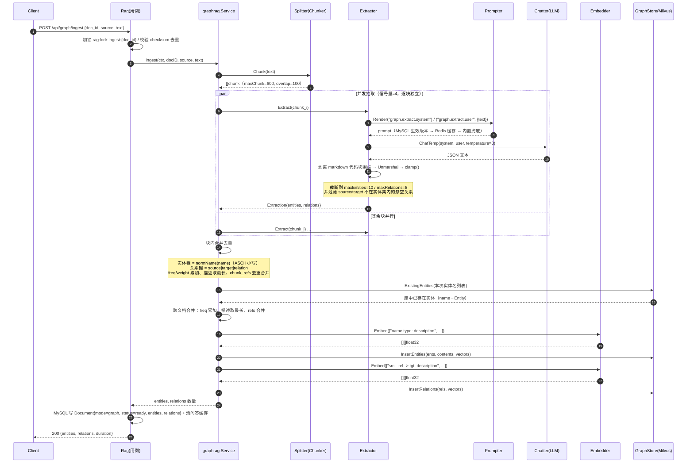
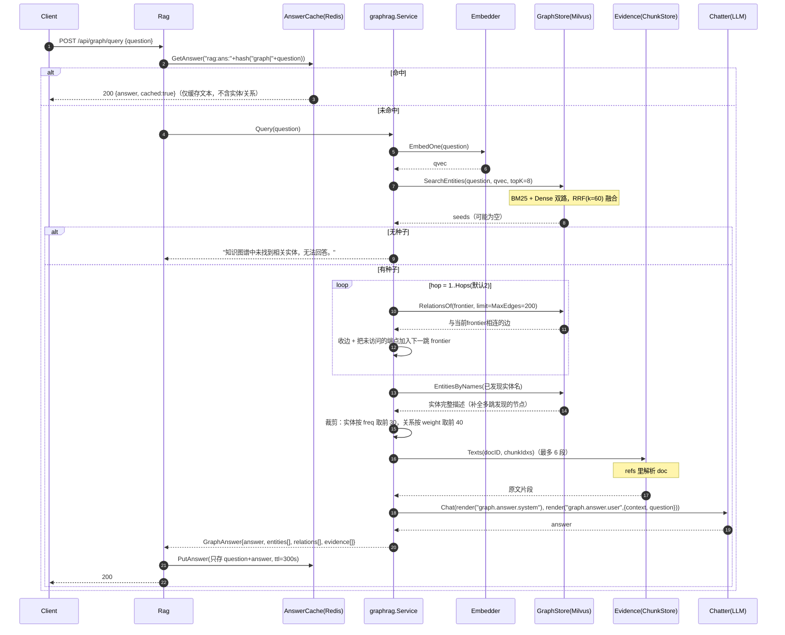
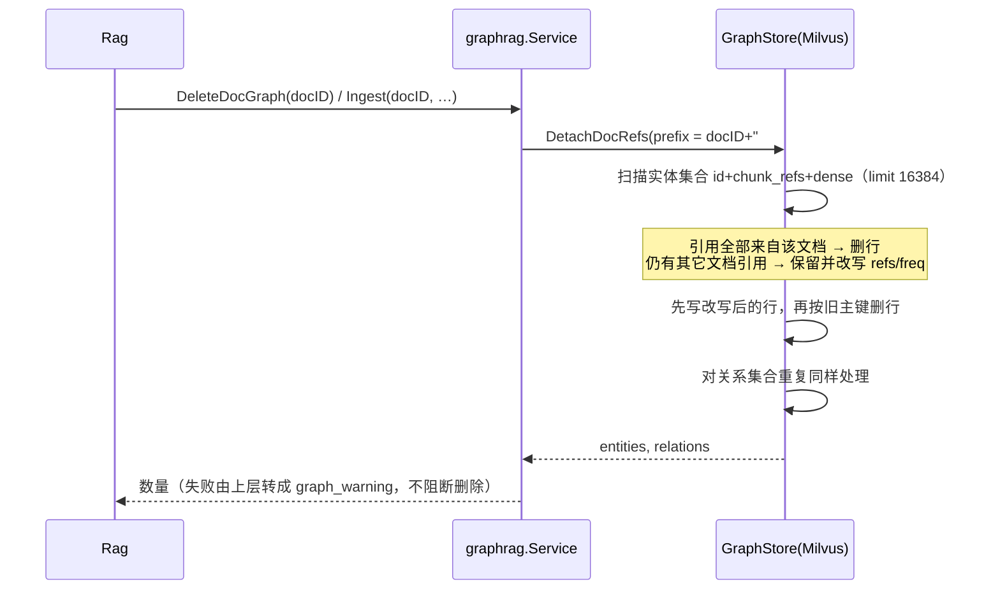

# GraphRAG 业务设计说明

> 代码位置：`internal/biz/rag/graphrag`（`service.go` / `extractor.go` / `types.go`）
> 存储实现：`internal/data/milvusdb/repo/graph.go`　上层入口：`internal/biz/rag`（`mode=graph`）
> 相关文档：[RAG 设计说明](../DESIGN.md)

## 1. 定位

GraphRAG 是 RAG 的**图谱线路**，与主线路（分块向量检索）并行、互不影响：

- **构建期**：文本分块 → LLM 抽取实体/关系 → 同文档合并去重 → 与库中已有实体跨文档合并 → 向量化写入 Milvus 图集合。
- **查询期**：问题向量 → 实体混合检索得到种子 → 沿关系边多跳扩展成子图 → 回查原文证据 → 组装上下文交给 LLM。

包内**只依赖接口**（`Store` / `Embedder` / `Chatter` / `Prompter` / `Splitter` / `Evidence`），
具体实现由 `rag.New` 注入：`Store` 来自 `data/milvusdb/repo.NewGraphStore`，`Splitter` 复用 `rag.Chunker`（避免包间循环依赖），`Evidence` 是 `rag` 里的 `evidenceAdapter`（用 `ChunkStore.GetTexts` 按 `doc#idx` 取回原文）。

## 2. 数据模型

两个 Milvus 集合，命名基于主分块集合名：`{base}_graph_entities`、`{base}_graph_relations`。

**实体集合**

| 字段 | 类型 | 说明 |
| --- | --- | --- |
| `id` | Int64 (auto) | 主键 |
| `name` | VarChar(512) | 实体名，合并去重的键（ASCII 小写归一化） |
| `type` | VarChar(64) | 实体类型（人物/组织/概念…） |
| `description` | VarChar(8192) | 描述，多来源时取最长 |
| `freq` | Int64 | 出现频次（块级合并 + 跨文档合并累加） |
| `chunk_refs` | VarChar(16384) | JSON 数组，元素形如 `docID#chunkIdx` |
| `source` | VarChar(16384) | `name type: description`，BM25 输入 |
| `sparse` / `dense` | Sparse/FloatVector | BM25 稀疏向量 + embedding 稠密向量 |

**关系集合**：`source` / `target` / `relation` / `description` / `weight`(Double) / `chunk_refs` / `dense`。
关系没有 `sparse` 字段，只按实体扩展取用，不做全文检索。

图语义：实体是节点，关系是有向边，边的两端**必须**是本次或库中已存在的实体名（抽取阶段会过滤悬空边）。

## 3. 流程一：图谱构建（`POST /api/graph/ingest`，mode=graph）

要点：

1. **并发限流 4**：抽取是纯 LLM 调用，单文档多块并行能把延迟压到 1/4，但必须限流避免打爆模型配额。
2. **temperature=0**：抽取要求输出稳定可解析的 JSON，不做创作。
3. **强一致过滤**：`clamp()` 截断数量上限，并丢弃「端点不在实体集合内」的关系，防止图里出现悬空边。
4. **两阶段合并**：先做**块内**合并（同一文档内同名实体），再做**跨文档**合并（`ExistingEntities`），保证全局实体唯一性近似成立。
5. **整篇失败**：任一块抽取失败即整体返回错误（`extract chunk N`），由 `rag.Ingest` 落 `status=failed` 元数据。

## 4. 流程二：图谱问答（`POST /api/graph/query`）

要点：

1. **种子→扩展→补全**三步走：向量召回解决「从哪进图」，多跳扩展解决「关联信息」，`EntitiesByNames` 解决「扩展到的节点只有名字没描述」。
2. **上下文有上限**：30 实体 + 40 关系 + 6 段原文证据，避免超出模型上下文并控制成本。
3. **证据可追溯**：`evidence` 来自主线路的分块集合（`ChunkStore.GetTexts`），保证图谱答案能回到原文，降低幻觉。
4. **图谱缓存只存文本**：实体/关系不回放（结构可能已变），命中时 `cached=true`。

## 5. 流程三：随文档删除 / 更新摘除图谱引用

设计意图有两层：

1. **不能误删共享实体**：多篇文档提到同一实体时，删掉其中一篇不该把实体一起删掉。
2. **也不能留下旧引用**：只删「全部引用都属于该文档」的节点是不够的——共享实体上这份文档的
   引用会一直留着，下次入库又被合并回新节点，旧 `chunk_idx` 还可能指向新版本的另一段内容。
   所以保留的节点要把它在这个来源下的引用摘掉（`refs` 重写、`freq` 按剩余引用重算）。

同一套 `DetachDocRefs` 也用于记忆侧（prefix 形如 `mem::{user}::{memoryID}#`），删除记忆时
不会再把「共享实体上的旧记忆引用」留下来。

## 6. 参数（`data.rag.graph*`）

| 参数 | 默认 | 作用 |
| --- | --- | --- |
| `graphTopK` | 8 | 种子实体召回数量 |
| `graphHops` | 2 | 关系扩展跳数（1 跳=直接邻居） |
| `graphMaxEdges` | 200 | 每跳最多取回的边数（防爆炸） |
| `graphMaxEntities` | 10 | 单块最多保留实体数 |
| `graphMaxRelations` | 8 | 单块最多保留关系数 |

## 7. 失败模式与降级

| 场景 | 行为 |
| --- | --- |
| 单块抽取超时/返回非 JSON | 整篇入库失败，`parse extraction` 附带原始响应前 200 字符便于排查 |
| 提示词服务不可用 | `renderPrompt` 回落 `prompt.RenderBuiltin`（key：`graph.extract.*`、`graph.answer.*`） |
| 实体检索无命中 | 返回固定文案，不调用 LLM |
| 证据回查失败 | 跳过该文档的证据，主流程继续 |
| 图谱清理失败 | 删除文档主流程照常完成，错误以 `graph_warning` 返回 |

## 8. 已知限制（改动前请注意）

1. **重复入库会累积实体行**：`InsertEntities` 是纯 insert（无按 `name` 的 upsert），重新入库同一文档会产生同名多行，`freq`/`refs` 只在写入时合并一次。清理需按 `doc_id` 删除或整体重建集合。同理，文档内容更新后旧关系行仍存在。
2. **实体归一化只做 ASCII 小写**：`normName` 不处理全半角、空格、别名（"K8s" vs "Kubernetes"），需要更强的实体对齐应引入 embedding 相似度或别名表。
3. **关系去重键不含描述**：`source|target|relation` 相同即视为同一条边，描述取先到者（合并时只累加 weight），多来源描述差异会丢失。
4. **查询期无全局图算法**：不做社区发现/PageRank/摘要（区别于微软 GraphRAG 的离线社区摘要），扩展是按跳数的 BFS，长尾问题依赖种子召回质量。
5. **每跳一次 `RelationsOf` 查询**：`Hops=2` 时约 1+2 次 Milvus 查询；调大 `Hops` 会线性增加开销与上下文规模。
6. **图谱规模统计来自集合行数**：Milvus 行数在 segment 未 flush 时可能偏小，`/api/admin/stats` 的 entities/relations 仅供参考。

## 9. 扩展点

| 想加什么 | 建议落点 |
| --- | --- |
| 更强的实体对齐（别名/同义） | `normName` 或 `ExistingEntities` 前加 embedding 相似度匹配 |
| 关系加权（按置信度/时间衰减） | `Extractor.clamp` 输出 weight，`generate` 排序处使用 |
| 社区摘要 / 全局问答 | 新增离线任务与集合，`Query` 中按问题类型路由 |
| 图上的 rerank | `SearchEntities` 后、`RelationsOf` 前 |
| 抽取提示词调整 | 管理端 `/api/prompts`，key `graph.extract.system` / `graph.extract.user` |
| 上下文裁剪策略 | `generate` 里的 30/40/6 三处上限 |
